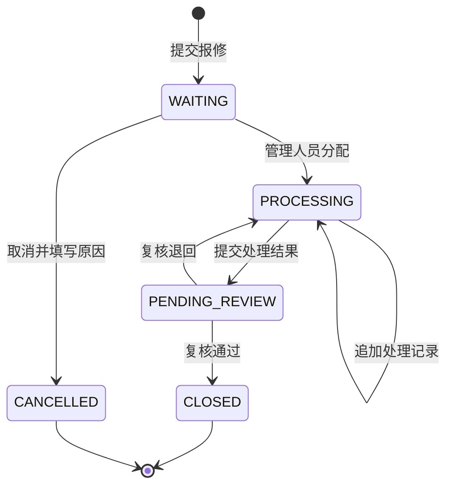
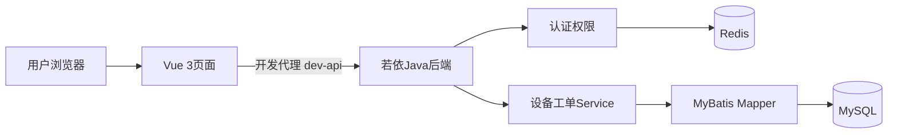

# 设备故障与维护记录管理系统

Equipment Fault and Maintenance Management System

本项目面向实验室设备管理场景，计划基于 Java 和若依开源后台构建设备台账、故障报修、维护处理、结果复核、历史追溯及基础统计功能。使用人员可以记录问题，维护人员可以跟踪处理，管理人员可以复核结果，并保留可查询的处理过程。

本 README 是后续开发的需求与设计基线，包含第一版范围、业务规则、技术方案、数据模型、接口约定、实施顺序和验收标准。当前已导入RuoYi 3.9.2前后端并固定提交，原版登录已验证。设备台账接口与页面、两张业务表、字典菜单和角色权限已实现，项目库共33表；20项单元测试、实际API验证、前端生产构建及后端完整打包通过。浏览器台账交互尚待验收，报修、处理、复核及统计仍待后续实施。实际导入版本见 [源码基线记录](docs/upstream-baseline.md)，第三方归属见 [来源说明](THIRD_PARTY_NOTICES.md)。

| 项目项 | 约定 |
| --- | --- |
| 中文名称 | 设备故障与维护记录管理系统 |
| 英文名称 | Equipment Fault and Maintenance Management System |
| 项目目录及仓库名 | `equipment-maintenance` |
| 本地路径 | `D:\VSCode\workspace\equipment-maintenance` |
| 后端目录 | `equipment-backend` |
| 前端目录 | `equipment-frontend` |
| MySQL 数据库 | `equipment_maintenance` |
| 第一版标识 | `v0.1.0`，待实现 |
| 文档设计日期 | 2026-10-14 |
| 开发工具 | VS Code、PowerShell、Git |
| 后端基座 | RuoYi-Vue 官方 `springboot3` 分支 |
| 前端基座 | 官方 RuoYi-Vue3，JavaScript 版本 |

## 目录

- [1 项目目标与范围](#1-项目目标与范围)
- [2 领域术语与设计原则](#2-领域术语与设计原则)
- [3 角色与权限](#3-角色与权限)
- [4 业务流程与状态](#4-业务流程与状态)
- [5 功能需求与验收条件](#5-功能需求与验收条件)
- [6 技术方案与框架改造](#6-技术方案与框架改造)
- [7 目录与代码组织](#7-目录与代码组织)
- [8 数据库设计](#8-数据库设计)
- [9 接口设计](#9-接口设计)
- [10 页面与交互](#10-页面与交互)
- [11 本地环境与初始化](#11-本地环境与初始化)
- [12 开发规范](#12-开发规范)
- [13 测试与验证](#13-测试与验证)
- [14 实施阶段](#14-实施阶段)
- [15 文档与交付物](#15-文档与交付物)
- [16 演示方案与项目说明](#16-演示方案与项目说明)
- [17 后续扩展](#17-后续扩展)
- [18 参考资料与开源来源](#18-参考资料与开源来源)

## 1 项目目标与范围

### 1.1 使用场景

以一个实验室为管理范围，登记电机、轴承试验台、振动采集设备等设备。使用人员发现异常后提交报修，管理人员分配维护人员，维护人员记录排查与处理过程，管理人员确认处理结果后关闭工单。

第一版使用明确标注的模拟设备与模拟工单数据，用于本地开发、学习、功能验证和项目演示。若后续接入真实实验室，应重新确认实际业务规则、人员权限和数据使用范围。

### 1.2 建设目标

1. 建立设备基本信息及使用状态台账。
2. 完成报修、分配、处理、复核、关闭的完整流程。
3. 按设备追溯故障与处理记录。
4. 按角色限制操作及数据访问范围。
5. 提供基础查询、统计和记录导出。
6. 从空数据库复现运行，保留设计与验证证据。

### 1.3 第一版包含

| 模块 | 第一版内容 |
| --- | --- |
| 基础账号 | 复用若依登录、用户、角色、菜单和权限 |
| 设备台账 | 新增、编辑、分页查询、状态调整、历史工单查询 |
| 故障报修 | 选择设备，填写现象、发生时间、类别与优先级 |
| 工单管理 | 列表、详情、分配、处理记录、提交复核、退回、关闭 |
| 工单取消 | 待受理阶段取消错误或重复报修，保留原因和记录 |
| 历史追溯 | 按设备查询工单，查看按时间排序的处理记录 |
| 基础统计 | 状态分布、故障类别、设备报修次数、平均闭环时长 |
| 导出 | 按权限和查询条件导出设备或工单列表 |
| 本地运行 | 前后端启动、数据库初始化、示例账号、模拟数据 |

### 1.4 第一版边界

第一版采用单体后端与一个实验室的管理范围。暂不提供备件采购与库存、定期保养排程、扫码或移动端、短信通知、流程设计器、多租户、微服务、消息队列、实时传感器采集、在线故障诊断模型或实际设备控制。

维护在本项目中指故障后的处理与记录；计划性保养作为后续独立功能。统计反映记录中的报修与流程情况，不直接证明设备实际可靠性或现场维修成效。

## 2 领域术语与设计原则

### 2.1 统一术语

| 术语 | 定义与使用约定 |
| --- | --- |
| 设备 | 可登记、使用和维护的实验室资产，每台具有唯一编号 |
| 设备台账 | 基本信息和使用状态的记录，不等同于实时运行监控 |
| 使用状态 | 在用、停用或报废，不等同于正常或故障的健康判断 |
| 故障现象 | 使用人员观察到的异常，如异响、发热、无法启动 |
| 故障原因 | 排查后对异常来源的判断，未确认时写待确认 |
| 报修 | 为一台设备登记一次需要处理的异常，一次报修生成一张工单 |
| 工单 | 跟踪一次报修及处理、复核结果的单据，具有独立编号和状态 |
| 处理记录 | 排查、处理或流程动作的记录，追加保存，普通功能不改写历史 |
| 处理措施 | 为解决异常采取的操作，与原因、结果分别描述 |
| 复核 | 管理人员确认处理结果，可以通过或退回，并填写说明 |
| 关闭 | 复核通过，结束本次工单流程，不自动表示设备恢复在用 |
| 取消 | 待受理阶段因误报或重复等结束，不计入已关闭工单 |
| 处理人 | 当前被分配负责工单的维护人员，服务端检查其关联 |
| 未结束工单 | 待受理、处理中或待复核；已关闭和已取消为结束状态 |

### 2.2 基本原则

- 设备使用状态与工单流程状态分别管理，关闭工单不自动变更设备状态。
- 同一设备允许多张未结束工单；提示已有报修，第一版不自动合并。
- 角色权限控制能做什么，对象数据范围控制能对哪张工单做，两者都在后端执行。
- 工单状态通过专用业务动作变更，不开放任意编辑状态的通用接口。
- 业务记录与若依操作日志分开：前者追溯处理过程，后者记录系统操作。
- 第一版不提供设备、工单、记录的物理删除入口；设备通过停用或报废保留历史。
- 发生时间由用户填写，提交时间和流程操作时间由服务端生成。
- 第一版业务时间按 `Asia/Shanghai` 展示与解释。数据库 `DATETIME` 按该约定存储，JVM、JSON序列化、JDBC配置保持一致。

## 3 角色与权限

### 3.1 角色定义

| 角色 | 若依标识 | 职责 |
| --- | --- | --- |
| 报修人员 | `eq_reporter` | 查询设备、创建报修、跟踪本人提交的工单 |
| 维护人员 | `eq_maintainer` | 处理分配给自己的工单，记录排查与措施 |
| 设备管理人员 | `eq_manager` | 管理设备、分配、复核、查询项目全量工单和统计 |
| 平台管理员 | 复用若依 `admin` | 初始化、账号权限配置、开发调试 |

演示账号每人分配一种业务角色。若具有多种角色，读取范围为授予范围的并集；动作仍需满足业务条件。平台管理员沿用框架权限，但不能绕过状态、必填和事务校验。

管理人员同时具有维护角色且被分配为处理人，才能填写处理结果。第一版不强制复核人与处理人为不同人员；常规演示使用不同账号完成处理和复核，不把页面复核描述为独立质量审核。

### 3.2 权限矩阵

| 操作 | 报修人员 | 维护人员 | 设备管理人员 |
| --- | --- | --- | --- |
| 查询设备及详情 | 是 | 是 | 是 |
| 新增、编辑、调整设备状态 | 否 | 否 | 是 |
| 提交报修 | 是 | 否 | 否 |
| 查询工单及记录 | 本人提交 | 当前分配给本人 | 项目全部 |
| 查看设备历史工单 | 范围内工单 | 范围内工单 | 项目全部 |
| 分配待受理工单 | 否 | 否 | 是 |
| 追加处理、提交复核 | 否 | 本人负责且处理中 | 否 |
| 复核通过或退回 | 否 | 否 | 是 |
| 取消待受理工单 | 本人提交 | 否 | 是 |
| 查询统计、导出设备 | 否 | 否 | 是 |
| 导出工单 | 本人范围 | 本人范围 | 项目全部 |

### 3.3 数据访问规则

1. 列表、详情、设备历史、记录和导出采用同一范围。
2. 报修人员条件为 `reporter_id = 当前用户ID`；维护人员为 `handler_id = 当前用户ID`；管理人员可访问本项目全部工单。
3. 请求中的报修人或处理人筛选不得代替当前用户的数据范围。服务端先限制范围，再叠加筛选。
4. 查询范围外工单统一按不存在返回，避免枚举其他工单。
5. 能看到设备不代表能看到该设备全部历史工单。
6. 有提交处理的功能权限，也必须是目标工单的处理人。
7. 分配对象必须存在、启用且具有维护角色。
8. 禁用用户不能继续提交动作；账号和角色变更沿用并验证若依登录失效和权限刷新行为。

## 4 业务流程与状态

### 4.1 工单状态

| 代码 | 中文 | 含义 |
| --- | --- | --- |
| `WAITING` | 待受理 | 已提交，尚未分配 |
| `PROCESSING` | 处理中 | 已分配维护人员 |
| `PENDING_REVIEW` | 待复核 | 已提交处理结果 |
| `CLOSED` | 已关闭 | 复核通过 |
| `CANCELLED` | 已取消 | 待受理阶段取消 |



### 4.2 流转规则

| 动作 | 当前状态 | 下一状态 | 必填内容与条件 |
| --- | --- | --- | --- |
| 创建报修 | 无 | `WAITING` | 在用设备、标题、现象、发生时间、类别、优先级 |
| 分配 | `WAITING` | `PROCESSING` | 有效维护人员，记录分配时间 |
| 追加处理 | `PROCESSING` | `PROCESSING` | 当前处理人、非空记录 |
| 提交复核 | `PROCESSING` | `PENDING_REVIEW` | 当前处理人、原因判断、措施、结果 |
| 复核退回 | `PENDING_REVIEW` | `PROCESSING` | 管理人员、退回原因 |
| 复核通过 | `PENDING_REVIEW` | `CLOSED` | 管理人员、复核结论 |
| 取消 | `WAITING` | `CANCELLED` | 本人报修或管理人员、取消原因 |

### 4.3 特殊情况

- 停用或报废设备不能新增报修，既有未结束工单仍可处理与关闭。
- 调整为停用时提示未结束工单数量，允许停用。
- 存在未结束工单不能报废；全部结束后才能报废。
- 报废为终态；在用与停用可以相互切换。
- 仅待受理可以取消；其他状态不能取消。
- 待复核不能追加处理，需要先退回。
- 第一版不提供处理中转派、已关闭重开、修改原始报修内容。
- 退回保留原处理人和历史，再提交新增记录，不覆盖上一轮结果。
- 错误报修在待受理取消后重建，不通过改写历史修正。
- 重复点击或多页面操作以版本及条件更新校验，不能重复流转。

### 4.4 完整业务示例

1. 登记模拟电机试验台 `EQ-0001`，使用状态在用。
2. 报修人员登记模拟异响，工单待受理。
3. 管理人员分配，工单处理中。
4. 维护人员记录排查过程，填写原因、措施、结果并提交。
5. 管理人员因结果说明不足退回，保留原因。
6. 维护人员补充后重提，管理人员通过。
7. 设备历史显示全部过程；工单关闭不自动改变设备使用状态。

## 5 功能需求与验收条件

### 5.1 设备台账

| 编号 | 需求 | 验收条件 |
| --- | --- | --- |
| EQ-01 | 新增 | 编号、名称、类型、位置必填，重复编号拒绝 |
| EQ-02 | 编辑 | 可改名称、型号、类型、位置、说明，列表详情一致 |
| EQ-03 | 查询 | 支持编号、名称、类型、状态，分页总数正确 |
| EQ-04 | 状态 | 仅管理人员调整，报废前检查未结束工单 |
| EQ-05 | 历史 | 展示范围内工单，能进入详情 |
| EQ-06 | 导出 | 遵守筛选，字段名称和状态可理解 |

编号创建后不可改；统一大写并去除首尾空格，最多32字符，允许字母、数字、连字符、下划线。名称和型号最多100，位置最多200，说明最多2000字符。第一版位置用文本，不增加位置树。

### 5.2 故障报修

| 编号 | 需求 | 验收条件 |
| --- | --- | --- |
| WO-01 | 创建 | 只能选择在用设备，生成唯一工单编号 |
| WO-02 | 校验 | 标题、现象、发生时间、有效类别和优先级必填，时间不晚于服务端当前时间 |
| WO-03 | 已有报修提示 | 显示当前用户可见的同设备未结束工单，可确认继续 |
| WO-04 | 身份与时间 | 服务端确定报修人、编号、状态、提交时间 |
| WO-05 | 取消 | 仅待受理，原因必填，生成记录 |

标题最多100，现象、原因、措施、结果、复核说明各最多2000字符。纯文本存储展示，不把用户内容作为HTML执行。提交中禁用按钮并复用框架防重复提交能力；第一版不宣称对网络重试提供严格的创建幂等保证。

初始故障类别为 `MECHANICAL`机械、`ELECTRICAL`电气、`ACQUISITION`采集与传感、`SOFTWARE`软件与控制、`OTHER`其他。类别是初步分类，不代表原因确认。优先级为 `LOW`、`NORMAL`、`HIGH`，用于排序筛选，不绑定响应时限。

### 5.3 处理与复核

| 编号 | 需求 | 验收条件 |
| --- | --- | --- |
| WO-06 | 分配 | 仅待受理，目标为有效维护人员，状态与记录同时保存 |
| WO-07 | 处理 | 仅当前处理人在处理中追加，他人直接请求也拒绝 |
| WO-08 | 提交 | 原因、措施、结果必填，提交后不可编辑该轮结果 |
| WO-09 | 退回 | 原因必填，保留历史，状态回到处理中 |
| WO-10 | 通过 | 结论必填，写关闭时间，关闭后仅查询 |
| WO-11 | 时间线 | 各动作按时间和记录ID稳定排序 |
| WO-12 | 并发 | 过期版本拒绝，不产生额外记录 |

原因可以如实写待确认；复核通过表示接受本次记录与结果，不自动诊断设备或替代维修规程。

### 5.4 查询与导出

工单筛选支持编号、设备、状态、类别、优先级、报修提交日期。管理人员额外可筛选报修人和处理人。默认创建时间降序、ID降序，每页10，最大100。

列表与导出采用同一条件和范围。复用若依Excel能力，单次最多1000条，超出提示缩小范围，不静默截断。导出编号、设备、类别、优先级、现象、人员、状态及流程时间；完整处理过程通过详情查看，第一版不导出全部时间线。

### 5.5 统计口径

仅管理人员访问，默认全部历史。筛选依据工单 `create_time` 和可选设备；结束日期转换成下一日零时，查询使用左闭右开区间。

| 指标 | 定义 |
| --- | --- |
| 设备总数与状态分布 | 全部设备，不受工单日期筛选影响 |
| 工单总数 | 筛选范围全部工单，含已取消 |
| 未结束数量 | 待受理、处理中、待复核之和 |
| 工单状态分布 | 五种状态数量之和等于总数 |
| 故障类别分布 | 同范围排除取消，按报修类别统计 |
| 设备报修次数 | 同范围排除取消，显示前10台，同次数按编号排序 |
| 平均闭环时长 | 同范围已关闭工单 `closed_time - create_time` 平均小时数 |

闭环时长包含等待、处理和复核，不称为实际维修时间或MTTR。无已关闭工单时返回无数据，不显示0小时。没有运行时长与实际故障起止依据时，不计算MTBF、稼动率、良率。

## 6 技术方案与框架改造

### 6.1 技术选型

| 层次 | 方案 | 约定 |
| --- | --- | --- |
| 语言 | Java 17 | 与后端基线一致 |
| 后端 | Spring Boot 3 | RuoYi-Vue `springboot3`分支 |
| 认证 | Spring Security、若依JWT与Redis登录状态 | 沿用框架 |
| 数据访问 | MyBatis、PageHelper | 不引入另一套ORM |
| 业务数据库 | MySQL 8.4 LTS、InnoDB、utf8mb4 | 保存业务数据 |
| 缓存 | Redis | 框架登录、验证码和缓存 |
| 前端 | Vue 3、JavaScript、Vite、Element Plus | 官方RuoYi-Vue3 |
| 图表 | 已有ECharts | 按统计需求实现 |
| 构建 | Maven、npm | 记录版本和锁文件 |
| 调试 | VS Code Java及Spring Boot扩展 | IDEA可选 |
| 仓库 | 单Git仓库 | 前后端同根目录 |

2026-10-14查阅的后端分支声明Java 17、Spring Boot 3.5.16、MyBatis Starter 3.0.5；前端声明Vue 3及Vite 6。正式导入后以固定提交的配置和锁文件为准。默认分支不能当作已选定的Spring Boot 3版本。[后端配置](https://github.com/yangzongzhuan/RuoYi-Vue/blob/springboot3/pom.xml)、[前端配置](https://github.com/yangzongzhuan/RuoYi-Vue3/blob/master/package.json)

### 6.2 数据流



### 6.3 复用与开发

| 类型 | 内容 |
| --- | --- |
| 保留 | 用户、角色、菜单、字典、登录、操作日志、分页、导出、代码生成 |
| 新增 | 业务实体、SQL、Service、Controller、页面、统计 |
| 配置 | 标题、业务菜单、按钮权限、连接、本地端口、时区 |
| 第一版不动 | 核心登录、Token存储、通用缓存、认证过滤器 |
| 暂不展示 | 无关演示菜单，先隐藏，不批量删除基座 |

代码生成用于设备CRUD和查询骨架。分配、提交、取消、通过、退回手工实现；通用修改接口不得任意写状态、处理人或操作时间。

### 6.4 数据库与缓存职责

MySQL保存设备、工单、记录、用户和权限。Redis满足框架登录、验证码与缓存依赖。业务统计直接查询MySQL，第一版不增加业务缓存。

删除Redis配置不会自动改为MySQL认证。移除Redis需独立设计与验证，不属于第一版。

## 7 目录与代码组织

以下为完整规划目录。目前已创建前后端源码目录、根Git忽略规则、第三方说明及 `docs/upstream-baseline.md`。业务SQL、前端锁文件及其他详细文档尚未创建，后续按实际完成情况更新。

```text
equipment-maintenance/
├── README.md
├── .gitignore
├── THIRD_PARTY_NOTICES.md
├── equipment-backend/
│   ├── LICENSE
│   ├── pom.xml
│   ├── ruoyi-admin/
│   ├── ruoyi-system/
│   ├── ruoyi-framework/
│   ├── ruoyi-common/
│   ├── ruoyi-generator/
│   ├── ruoyi-quartz/
│   └── sql/                        # 保留上游脚本及来源
├── equipment-frontend/
│   ├── LICENSE
│   ├── package.json
│   ├── package-lock.json
│   └── src/
│       ├── api/equipment/
│       └── views/equipment/
├── sql/
│   ├── 001_business_schema.sql
│   ├── 002_business_dict_menu.sql
│   ├── 003_demo_data.sql
│   └── changes/                    # 实际变更时再创建
└── docs/
    ├── upstream-baseline.md
    ├── requirements.md
    ├── development-design.md
    ├── database.md
    ├── api.md
    ├── verification.md
    ├── local-setup.md
    └── development-notes.md
```

### 7.1 后端组织

沿用若依Maven模块，将业务类放入独立包，第一版不为小项目新增Maven模块。

| 内容 | 规划位置 |
| --- | --- |
| Controller | `ruoyi-admin/src/main/java/com/ruoyi/web/controller/equipment/` |
| 领域类、DTO、VO | `ruoyi-system/src/main/java/com/ruoyi/equipment/` 下 `domain/`、`dto/`、`vo/` |
| Service | 同业务包下 `service/` 及实现 |
| Mapper接口 | 同业务包下 `mapper/` |
| Mapper XML | `ruoyi-system/src/main/resources/mapper/equipment/` |
| 状态枚举 | 同业务包下 `enums/` |
| 测试 | 对应模块 `src/test/java/` |

新增包后核对组件、Mapper扫描和XML加载。Controller处理入口，Service负责范围、状态、事务和校验，Mapper负责持久化。DTO只接收允许填写的字段，不直接绑定完整实体。

### 7.2 前端组织

`api/equipment/` 按设备、工单、统计拆分请求；`views/equipment/` 按台账、报修、列表、详情、统计拆分页面。复用请求封装、字典、分页和权限指令，不建立第二套登录状态管理。

## 8 数据库设计

### 8.1 统一约定

- 数据库 `equipment_maintenance`，InnoDB、utf8mb4。
- 表前缀 `eq_`，字段小写下划线。
- 主键BIGINT自增；接口数据库ID统一以字符串传输，避免JavaScript精度问题。
- 状态用VARCHAR配合Java枚举，有效分类配合字典，不使用MySQL ENUM。
- 必填、唯一、引用约束落实到SQL，业务含义由Service验证。
- 时间DATETIME精度为秒，按Asia/Shanghai统一解释。
- 业务表无物理删除入口；参与业务的账号停用代替删除。
- 字段类型、外键与索引通过实际MySQL验证后写入脚本，此处设计不代表DDL已执行。

### 8.2 系统表复用

复用 `sys_user`、`sys_role`、`sys_user_role`、`sys_menu`、`sys_role_menu`、`sys_dict_type`、`sys_dict_data` 等框架表，不另建登录用户表。系统操作日志保留原实现。

### 8.3 设备表 eq_equipment

| 字段 | 类型 | 必填 | 含义 |
| --- | --- | --- | --- |
| `equipment_id` | BIGINT | 是 | 主键 |
| `equipment_code` | VARCHAR(32) | 是 | 唯一编号，创建后不可改 |
| `equipment_name` | VARCHAR(100) | 是 | 名称 |
| `equipment_type` | VARCHAR(32) | 是 | 类型字典代码 |
| `model` | VARCHAR(100) | 否 | 型号 |
| `location` | VARCHAR(200) | 是 | 位置 |
| `equipment_status` | VARCHAR(32) | 是 | `IN_SERVICE`在用、`OUT_OF_SERVICE`停用、`RETIRED`报废 |
| `version` | INT | 是 | 初值0，编辑与状态变更递增 |
| `create_by` | VARCHAR(64) | 是 | 创建账号 |
| `create_time` | DATETIME | 是 | 创建时间 |
| `update_by` | VARCHAR(64) | 否 | 最近更新账号 |
| `update_time` | DATETIME | 否 | 最近更新时间 |
| `remark` | VARCHAR(2000) | 否 | 说明 |

设备编号唯一，初始组合索引 `(equipment_type, equipment_status)`。其他索引按实际查询需要增加。报废设备保留历史。

### 8.4 工单表 eq_work_order

| 字段 | 类型 | 必填 | 含义 |
| --- | --- | --- | --- |
| `work_order_id` | BIGINT | 是 | 主键 |
| `work_order_no` | VARCHAR(40) | 是 | 唯一展示编号 |
| `equipment_id` | BIGINT | 是 | 设备ID |
| `title` | VARCHAR(100) | 是 | 标题 |
| `symptom` | VARCHAR(2000) | 是 | 原始故障现象 |
| `fault_category` | VARCHAR(32) | 是 | 类别代码 |
| `priority` | VARCHAR(16) | 是 | LOW、NORMAL、HIGH |
| `occurred_time` | DATETIME | 是 | 用户填写的发生时间 |
| `reporter_id` | BIGINT | 是 | 报修人员ID |
| `handler_id` | BIGINT | 否 | 分配的处理人ID |
| `status` | VARCHAR(32) | 是 | 工单状态 |
| `assigned_time` | DATETIME | 否 | 首次分配时间 |
| `last_submit_time` | DATETIME | 否 | 最近提交复核时间 |
| `closed_time` | DATETIME | 否 | 通过复核时间 |
| `cancelled_time` | DATETIME | 否 | 取消时间 |
| `version` | INT | 是 | 初值0，每次业务写操作递增 |
| `create_by` | VARCHAR(64) | 是 | 创建账号 |
| `create_time` | DATETIME | 是 | 提交时间及统计筛选基准 |
| `update_by` | VARCHAR(64) | 否 | 最近操作账号 |
| `update_time` | DATETIME | 否 | 最近操作时间 |

编号采用服务端 `WO-` 加无连字符UUID，长度35，不依赖Redis计数，也不提供连续流水号。原因、措施、结果、复核结论放在对应记录中，详情聚合最新提交及历史，避免主表重复维护结果。

唯一约束为工单编号。设备、报修人与非空处理人具有引用约束；索引初始为 `(equipment_id, create_time)`、`(reporter_id, create_time)`、`(handler_id, status, create_time)`、`(status, create_time)`。引用 `sys_user` 前确认固定基线的字段类型与符号一致，不级联删除业务数据。

### 8.5 记录表 eq_work_order_record

| 字段 | 类型 | 必填 | 含义 |
| --- | --- | --- | --- |
| `record_id` | BIGINT | 是 | 主键 |
| `work_order_id` | BIGINT | 是 | 所属工单 |
| `action_type` | VARCHAR(32) | 是 | 动作类型 |
| `from_status` | VARCHAR(32) | 否 | 前状态，创建时可为空 |
| `to_status` | VARCHAR(32) | 是 | 后状态 |
| `description` | VARCHAR(2000) | 是 | 动作说明、排查内容或复核结论 |
| `cause_analysis` | VARCHAR(2000) | 否 | 提交复核的原因判断 |
| `measures` | VARCHAR(2000) | 否 | 提交复核的措施 |
| `result_description` | VARCHAR(2000) | 否 | 提交复核的结果 |
| `actor_id` | BIGINT | 是 | 操作人ID |
| `actor_name` | VARCHAR(100) | 是 | 操作人显示名快照 |
| `create_time` | DATETIME | 是 | 服务端操作时间 |

动作代码：`CREATE`、`ASSIGN`、`PROCESS_NOTE`、`SUBMIT_REVIEW`、`REVIEW_REJECT`、`REVIEW_APPROVE`、`CANCEL`。提交复核三个结果字段均必填；其他动作可为空。分配说明记录处理人信息。表为追加式，不提供修改删除接口。

工单和操作人引用不得级联删除；索引 `(work_order_id, create_time, record_id)` 用于时间线。

### 8.6 字典设计

初始化 `eq_equipment_type`、`eq_equipment_status`、`eq_fault_category`、`eq_priority`、`eq_work_order_status`。设备类型初始为电机、试验台、采集设备、其他。

状态与优先级是固定契约，修改字典显示文字不改变状态规则。类型或类别停用后，旧记录继续显示历史代码或名称，新记录不能选择停用值。脚本使用固定代码，避免重复初始化。

### 8.7 事务与并发一致性

1. 创建工单与创建记录同一事务。
2. 分配、追加、提交、退回、通过、取消的主表写入和记录同一事务。
3. 请求携带读取时的version。检查对象权限、状态和必填后条件更新，影响行数必须为1。
4. 追加处理虽不改状态，也递增版本；关闭后旧页面不能再写入。
5. 创建报修和调整使用状态在事务内先锁设备行，检查在用或未结束工单，防止报废检查与报修竞争。
6. 涉及设备锁时统一先设备、后工单，后续动作同样遵守。
7. 记录写入失败须回滚主表变更，不产生没有记录的状态。

SQL示意，实际参数使用MyBatis绑定：

```sql
UPDATE eq_work_order
SET status = :next_status,
    version = version + 1,
    update_by = :current_user,
    update_time = :server_time
WHERE work_order_id = :id
  AND status = :expected_status
  AND version = :expected_version;
```

示意不替代对象权限校验。处理动作还需约束当前处理人，事务中读取或条件更新必须保障关联校验有效。

## 9 接口设计

### 9.1 统一约定

后端前缀 `/equipment`。开发浏览器请求 `/dev-api/equipment/asset/list`，经代理转为后端 `/equipment/asset/list`。

沿用若依 `AjaxResult`、`TableDataInfo`。列表包含code、msg、rows、total，详情或动作包含code、msg、data。业务code与HTTP状态是两个层次；保留框架认证错误处理并核对前端拦截器，不擅自更换为不兼容格式。

业务code：200成功、400参数或流转不合法、403动作无权限、404对象不存在或超出范围、409版本冲突、500内部异常。若框架业务异常无法区分，统一实现业务映射并验证，不逐Controller各自拼接。未登录沿用框架401处理。

### 9.2 设备接口

| 方法 | 路径 | 用途 | 权限标识 |
| --- | --- | --- | --- |
| GET | `/equipment/asset/list` | 分页查询 | `equipment:asset:list` |
| GET | `/equipment/asset/options` | 在用设备选择，带关键词和分页限制 | `equipment:asset:query` |
| GET | `/equipment/asset/{id}` | 详情 | `equipment:asset:query` |
| POST | `/equipment/asset` | 新增 | `equipment:asset:add` |
| PUT | `/equipment/asset/{id}` | 编辑允许字段 | `equipment:asset:edit` |
| PUT | `/equipment/asset/{id}/status` | 调整使用状态 | `equipment:asset:status` |
| GET | `/equipment/asset/{id}/work-orders` | 范围内历史 | `equipment:workorder:list` |
| POST | `/equipment/asset/export` | 导出 | `equipment:asset:export` |

### 9.3 工单接口

| 方法 | 路径 | 用途 | 权限标识 |
| --- | --- | --- | --- |
| GET | `/equipment/workorder/list` | 范围内查询 | `equipment:workorder:list` |
| GET | `/equipment/workorder/{id}` | 详情和最新结果 | `equipment:workorder:query` |
| GET | `/equipment/workorder/{id}/records` | 时间线 | `equipment:workorder:query` |
| GET | `/equipment/workorder/maintainers` | 启用维护人员选择 | `equipment:workorder:assign` |
| POST | `/equipment/workorder` | 创建 | `equipment:workorder:add` |
| POST | `/equipment/workorder/{id}/assign` | 分配 | `equipment:workorder:assign` |
| POST | `/equipment/workorder/{id}/records` | 追加处理 | `equipment:workorder:process` |
| POST | `/equipment/workorder/{id}/submit-review` | 提交复核 | `equipment:workorder:submit` |
| POST | `/equipment/workorder/{id}/review` | 通过或退回 | `equipment:workorder:review` |
| POST | `/equipment/workorder/{id}/cancel` | 取消 | `equipment:workorder:cancel` |
| POST | `/equipment/workorder/export` | 范围内导出 | `equipment:workorder:export` |

### 9.4 统计接口

`GET /equipment/statistics/overview`，权限 `equipment:statistics:query`。接收beginDate、endDate、可选equipmentId，返回第5.5节指标。空均值返回null，页面显示无数据。

### 9.5 请求示例

创建报修，ID字符串，时间仅示意，实际不能晚于提交时的服务端时间：

```json
{
  "equipmentId": "1",
  "title": "模拟电机运行出现异响",
  "symptom": "运行后出现持续异响，停止运行后声音消失。",
  "faultCategory": "MECHANICAL",
  "priority": "NORMAL",
  "occurredTime": "2026-10-14 09:30:00"
}
```

创建不接收报修人、编号、状态或创建时间。分配接收handlerId、version及可选说明；追加记录接收description和version。提交复核示例：

```json
{
  "version": 2,
  "causeAnalysis": "模拟排查显示连接部位松动，其他原因待确认。",
  "measures": "模拟检查并重新紧固连接位置。",
  "resultDescription": "模拟复查未出现原异响，提交复核。"
}
```

复核接收decision为APPROVE或REJECT、description、version。取消接收reason、version。编辑设备和调整状态也携带version。

### 9.6 响应示例

```json
{
  "code": 200,
  "msg": "操作成功",
  "data": {
    "workOrderId": "1",
    "workOrderNo": "WO-00000000000000000000000000000001",
    "status": "WAITING",
    "version": 0
  }
}
```

成功返回新状态和版本，页面刷新详情。冲突提示数据已更新，请刷新，不自动用新版本重交用户动作。

## 10 页面与交互

### 10.1 业务菜单

设备维护管理下规划设备台账、故障报修、工单管理、统计分析。由角色动态展示菜单。

| 页面 | 内容 |
| --- | --- |
| 设备台账 | 筛选、分页、新增编辑、状态、详情与范围内历史 |
| 故障报修 | 在用设备选择、故障表单、已有报修提示 |
| 工单管理 | 查询、状态、人员、按角色和状态显示动作 |
| 工单详情 | 原始报修、当前处理人、最新结果、时间线、业务动作 |
| 统计 | 筛选、数量、分布图、排名、闭环时长 |

### 10.2 交互要求

- 前后端均校验，失败保留已填写内容。
- 按角色与状态展示按钮，后端独立校验。
- 无结果、加载中、失败分别有提示。
- 分配、取消、复核通过、报废先确认对象；退回要求原因。
- 创建成功进入详情或刷新，防止误认为失败。
- 分开显示现象、原因、措施、结果、复核结论。
- 时间线不混入框架访问日志。
- 标题使用项目名称，项目说明保留开源来源。
- 以桌面浏览器为主，验证常用窗口下表格弹窗可用，第一版不单独做移动端布局。

## 11 本地环境与初始化

源码已经导入，版本记录见 [源码基线](docs/upstream-baseline.md)。本节中的导入及数据库初始化步骤供重新构建基线时参考，不应覆盖现有源码或重复初始化已有数据。框架表与开发账号已初始化，后端配置、构建及启动成功；前端依赖安装、原版登录与生产构建已完成。设备台账的实际初始化与访问见 [台账模块说明](docs/equipment-ledger.md)。

### 11.1 环境清单

| 工具服务 | 基线建议 | 验证方式 |
| --- | --- | --- |
| JDK | 项目运行及编译17 | `java -version`、`javac -version` |
| Maven | 3.9.x | `mvn -version`，确认使用的Java |
| Node.js | 22.x LTS并满足固定依赖要求 | `node -v` |
| npm | 随Node安装，记录实际版本 | `npm -v` |
| MySQL | 8.4 LTS | `mysql --version`，另验证服务可连接 |
| Redis | 与固定若依版本兼容的本地服务 | `redis-cli ping`返回PONG |
| Git | 已安装版本 | `git --version` |
| VS Code | 已有版本 | 安装Java、Spring Boot扩展包 |

VS Code Java语言服务器的运行时要求可能不同于项目JDK。如果扩展要求更高JDK，分别配置扩展运行时和项目JDK17，不为编辑器要求直接升级项目Java版本。

Windows下Redis可使用已经配置的WSL2或Docker Desktop。选择一种可用方式，没有环境时另行准备，不默认下载多种运行环境，也不依赖陈旧Windows移植版。业务数据仍使用MySQL。

本地端口约定：后端8080、前端5173、MySQL3306。本机Redis实际监听 `127.0.0.1:6399`，后端已按该端口配置；6379只是Redis通常默认端口。官方前端当前快照默认端口80，导入后改为5173并限制开发访问到本机。[前端配置来源](https://github.com/yangzongzhuan/RuoYi-Vue3/blob/master/vite.config.js)

### 11.2 基座导入与版本固定

整体一个Git仓库。先将上游克隆到独立临时目录，再导出源码，避免前后端形成嵌套Git仓库。以下命令仅在目标源码目录不存在时使用，不能覆盖已有代码。初始化时确定前后端兼容的发布版本或提交，完成原版登录，再开始业务改造。

```powershell
$projectRoot = 'D:\VSCode\workspace\equipment-maintenance'
$sourceRoot = Join-Path $env:TEMP ('equipment-upstream-' + [guid]::NewGuid().ToString('N'))
New-Item -ItemType Directory -Path $sourceRoot | Out-Null

$backendTarget = Join-Path $projectRoot 'equipment-backend'
$frontendTarget = Join-Path $projectRoot 'equipment-frontend'
if ((Test-Path -LiteralPath $backendTarget) -or (Test-Path -LiteralPath $frontendTarget)) {
    throw '目标源码目录已存在，请检查已有代码，不要重复导入。'
}

$backendSource = Join-Path $sourceRoot 'RuoYi-Vue'
$frontendSource = Join-Path $sourceRoot 'RuoYi-Vue3'
git clone --branch springboot3 --single-branch https://github.com/yangzongzhuan/RuoYi-Vue.git $backendSource
if ($LASTEXITCODE -ne 0) { throw '后端克隆失败' }
git clone https://github.com/yangzongzhuan/RuoYi-Vue3.git $frontendSource
if ($LASTEXITCODE -ne 0) { throw '前端克隆失败' }

$backendCommit = git -C $backendSource rev-parse HEAD
$frontendCommit = git -C $frontendSource rev-parse HEAD
$backendZip = Join-Path $sourceRoot 'backend.zip'
$frontendZip = Join-Path $sourceRoot 'frontend.zip'
git -C $backendSource archive --format=zip --output=$backendZip HEAD
if ($LASTEXITCODE -ne 0) { throw '后端源码导出失败' }
git -C $frontendSource archive --format=zip --output=$frontendZip HEAD
if ($LASTEXITCODE -ne 0) { throw '前端源码导出失败' }
Expand-Archive -LiteralPath $backendZip -DestinationPath $backendTarget
Expand-Archive -LiteralPath $frontendZip -DestinationPath $frontendTarget

Write-Output "后端基线提交：$backendCommit"
Write-Output "前端基线提交：$frontendCommit"
```

网络需要时可使用同一官方项目的Gitee地址，不混用第三方同名仓库。记录URL、分支、完整SHA、导入日期、框架版本、Java/Maven/Node/npm版本至 `docs/upstream-baseline.md`。若前后端版本不同，先切换兼容标签或提交再重新导出；不能只记录版本而不验证登录与权限。

导入保留根README。准备根 `.gitignore`，初始化Git并提交基座。后续依赖以固定代码和锁文件为准，升级上游作为独立变更，不在业务开发中直接拉取默认分支。

### 11.3 MySQL初始化

1. 启动MySQL，确认管理员可连接。
2. 创建专用数据库，不修改或清空其他数据库。
3. 创建 `equipment_dev` 本地账号，授予该库所需开发权限。
4. 导入固定上游版本要求的框架SQL，文件名可能带日期，不照抄旧日期。
5. 原版运行后，依次导入业务建表、字典菜单、模拟数据。

```sql
CREATE DATABASE equipment_maintenance
  CHARACTER SET utf8mb4
  COLLATE utf8mb4_unicode_ci;
```

账号密码自行设置，不写入README、数据脚本或Git。首次初始化需建表和插入权限。查看实际上游脚本：

```powershell
Get-ChildItem -LiteralPath '.\equipment-backend\sql' -Filter '*.sql'
```

在MySQL客户端先选择 `equipment_maintenance`，再用 `SOURCE` 导入所选版本的主脚本及其要求的任务表脚本。业务SQL按001、002、003执行。模拟数据只用于空的本地演示库，不能向真实业务库或已有开发数据重复导入。

### 11.4 后端配置

本地开发维持若依原版的直接配置形式。主库连接信息写在 `equipment-backend/ruoyi-admin/src/main/resources/application-druid.yml`，启动时自动读取，不需要先运行输入密码或设置环境变量的命令。

当前本地配置使用 `localhost:3306/equipment_maintenance`、用户 `equipment_dev`，密码已填写为经过MySQL连接验证的值。下列示例只表示格式，不展示真实密码，也不要用占位文字覆盖已经配置好的文件：

```yaml
spring:
  datasource:
    druid:
      master:
        url: jdbc:mysql://localhost:3306/equipment_maintenance?useUnicode=true&characterEncoding=utf8&serverTimezone=GMT%2B8
        username: equipment_dev
        password: 'YOUR_DATABASE_PASSWORD'
```

本地 `application-druid.yml` 已加入根Git忽略规则。可共享的 `application-druid.example.yml` 保留完整数据源配置结构，但密码仅为占位值。首次在另一台电脑检出项目时，将示例复制为 `application-druid.yml`，填写当地账号密码；当前电脑已有实际配置，不需要执行复制覆盖。

数据库账号密码变更时修改该文件。使用打包JAR启动时，修改源码配置后需重新执行 `mvn package`，然后再启动新JAR。JAR包含运行配置，因此构建产物仍只保存在被忽略的target目录。

本项目当前不再读取 `EQ_DB_USER` 或 `EQ_DB_PASSWORD`。此前保存的这两个用户环境变量不影响本次直接配置，无需为启动重新输入或设置。不要在README、数据初始化SQL和共享示例中填写真实密码。

Redis保持已经验证的本机连接配置，默认地址为 `127.0.0.1:6399`、密码为空；其可选环境变量保留，不要求日常设置。Token密钥仍是后续本地配置事项。

`ruoyi.profile` 使用项目外可写目录，例如 `D:/VSCode/local-data/equipment-maintenance/uploads`。第一版无业务附件，框架配置仍有效。JVM、JDBC和JSON日期设置遵守统一时区。

### 11.5 前端配置

`.env.development` 中 `VITE_APP_TITLE` 改为中文项目名，保留 `VITE_APP_BASE_API=/dev-api`。`vite.config.js` 开发端口5173，host为 `127.0.0.1`，代理到 `http://127.0.0.1:8080`。

前端变量会进入浏览器，不能放数据库密码、Redis密码或Token签名密钥。生产静态文件需要实际反向代理，不能假设开发代理随构建文件部署。

### 11.6 启动与构建

前端首次安装：

```powershell
Set-Location -LiteralPath 'D:\VSCode\workspace\equipment-maintenance\equipment-frontend'
npm install
npm run dev -- --host 127.0.0.1 --port 5173
```

首次确认并提交 `package-lock.json`，后续使用 `npm ci`。不同时维护多种包管理器锁文件。

后端构建全部模块：

```powershell
Set-Location -LiteralPath 'D:\VSCode\workspace\equipment-maintenance\equipment-backend'
mvn clean package
```

确认本地数据库配置后，在VS Code运行 `ruoyi-admin` 中 `com.ruoyi.RuoYiApplication`，或执行打包应用：

```powershell
java '-Duser.timezone=Asia/Shanghai' -jar '.\ruoyi-admin\target\ruoyi-admin.jar'
```

JAR名称以固定基线为准。浏览器访问 `http://127.0.0.1:5173`，8080为后端接口。首次登录使用所选上游文档中的初始账号，随后修改密码并创建业务账号，不固定真实密码到项目文档。

PowerShell中将整个 `-Duser.timezone=Asia/Shanghai` 参数放在引号内。未加引号时，当前环境会把该参数错误拆分，出现找不到主类 `.timezone=Asia.Shanghai`。修正启动命令即可，无需重新打包。可用 `java '-Duser.timezone=Asia/Shanghai' -XshowSettings:properties -version` 检查时区是否读取为 `Asia/Shanghai`，该检查不启动应用。

前端构建，在前端目录执行：

```powershell
npm run build:prod
```

构建通过不代表业务验证通过。核对上游是否默认跳过测试，显式测试方式见第13节。

### 11.7 首次启动检查

- [x] 基座SHA和环境版本已记录。
- [x] 31张框架表已导入，后端启动时数据库查询成功。
- [x] 本机Redis `127.0.0.1:6399` 连通，PING返回PONG。
- [x] 后端日志显示Started RuoYiApplication及若依启动成功。
- [x] 原版登录正常，用户已确认。
- [ ] 代理、端口一致，登录后菜单加载。
- [ ] 日志无持续连接或映射错误。
- [ ] 前端构建、后端打包通过。
- [x] Git忽略产物、日志、本地配置和上传数据。
- [ ] 初始密码和Token密钥已调整。

### 11.8 常见问题

| 现象 | 优先检查 |
| --- | --- |
| Java包无法识别 | 打开后端根目录，等待Maven导入，核对JDK |
| 找不到主类 `.timezone=Asia.Shanghai` | 将整个 `-Duser.timezone=Asia/Shanghai` 参数加引号，使用本节修正后的命令，无需重新构建 |
| Maven下载或编译失败 | 第一个实际错误，网络、依赖、Maven使用的JDK |
| 数据库拒绝连接 | 服务、主机、端口、授权及application-druid.yml中的账号密码 |
| 表不存在 | 数据库名、固定框架SQL、业务执行顺序 |
| 登录或验证码失败 | Redis、初始化账号、响应及后端日志 |
| Redis连接6379被拒绝 | 本机实际端口为6399；核对配置或EQ_REDIS_PORT，修改源码配置后重新打包再启动 |
| 请求404 | dev-api、代理目标、后端路径 |
| 端口占用 | 查看实际端口，不停止未知进程 |
| 菜单按钮未出现 | 路由、角色菜单、权限标识、登录权限刷新 |
| Mapper无法加载 | 扫描、XML位置、namespace、方法名称 |
| 时间差8小时 | JVM、JDBC、JSON和页面时区 |

## 12 开发规范

### 12.1 代码与业务规则

- 沿用固定若依版本的Java风格与结构，不先大规模重构基座。
- 状态和动作用常量或枚举，避免多个文件重复不一致字符串。
- Service负责事务与规则，Controller不承载长段状态处理。
- SQL参数绑定，排序字段白名单，不拼接用户文本作为SQL字段。
- DTO仅接收允许字段，用户、时间、状态与作者由服务端确定。
- 查询与写入均检查范围，不依赖隐藏按钮防越权。
- 批量查询设备和用户显示信息，避免列表逐条查询。
- 错误提示可理解，不向页面暴露密码、连接或完整堆栈。
- 去掉生成代码中不符合范围的删除与任意状态修改入口。
- 统计接口多条查询需要在同一只读事务和一致快照中执行，避免并发写入时总数与分布自相矛盾。

### 12.2 Git与变更

阶段完成后提交代码、SQL及文档，建议 `docs:`、`feat:`、`fix:`、`test:` 等前缀。共享库已执行的结构脚本不直接改写历史，新增变更脚本并记录顺序。

忽略target、node_modules、dist、日志、上传数据及真实本地配置。保留锁文件、业务SQL、示例配置；含本地数据库密码的application-druid.yml不提交，使用application-druid.example.yml共享结构。改名、复制框架页面和生成代码数量不作为主要贡献。

### 12.3 文档同步

字段、接口、状态变更同步更新设计、验证和README。拆出的文档与README冲突时先统一，不静默选择一种。需求编号含义保持稳定，调整时说明原因。

## 13 测试与验证

围绕业务结果、权限、事务和流转验证，不只检查方法调用。低影响页面样式调整以人工检查为主。

### 13.1 必须验证的场景

| 编号 | 场景 | 预期 |
| --- | --- | --- |
| T-01 | 重复设备编号 | 拒绝，原记录不变 |
| T-02 | 停用报废设备报修 | 工单和记录不新增 |
| T-03 | 正常创建分配提交通过 | 状态记录一致，关闭时间有效 |
| T-04 | 退回后重新提交 | 保留全部轮次，最终可关闭 |
| T-05 | 未填措施或结果直接提交 | 后端拒绝，不变状态 |
| T-06 | 他人维护账号提交 | 拒绝，不产生记录 |
| T-07 | 报修人读取他人工单记录 | 列表无该数据，详情按不存在 |
| T-08 | 修改筛选或导出他人数据 | 范围不扩大 |
| T-09 | 过期版本或并发提交 | 仅一次成功，另一提示冲突 |
| T-10 | 模拟记录写入失败 | 主表回滚 |
| T-11 | 待受理与处理中取消 | 前者有记录，后者拒绝 |
| T-12 | 关闭后再次处理 | 拒绝，历史不变 |
| T-13 | 未结束工单设备报废 | 拒绝，全部结束后才能报废 |
| T-14 | 报废与报修并发 | 不出现报废设备新增工单 |
| T-15 | 日期边界及无闭环数据 | 范围一致，空均值null |
| T-16 | 导出及超过1000条 | 筛选权限一致，超限提示 |
| T-17 | 分配给禁用账号 | 拒绝，仍待受理 |
| T-18 | 空数据库重新初始化 | 登录和演示可复现 |

### 13.2 分层验证

- 单元：状态、参数、结果口径等独立业务逻辑。
- 集成：实际MySQL查询、约束、条件更新、回滚、锁行为。
- API：不同账号验证功能权限、对象范围、字段伪造。
- 页面：流程、提示、退回、刷新及导出内容。

数据库集成测试使用独立 `equipment_maintenance_test`，不能清理正常开发库。Redis测试使用独立逻辑库或键前缀，不能清空开发服务。测试profile与环境变量隔离，不为测试额外引入完整分布式基础设施。

### 13.3 执行与结果

有测试后，在后端根目录显式执行：

```powershell
mvn test -DskipTests=false -Dmaven.test.skip=false
```

若基座有其他跳过规则，核对有效POM并记录实际命令。设备台账已增加Service业务测试，并完成实际API验证；数量与结果见 docs/verification.md。前端构建通过不等于页面流程测试通过。

`docs/verification.md` 按编号记录日期、提交、环境、步骤、实际结果、必要证据；尚未执行标为未验证。

## 14 实施阶段

以完成条件推进，不以预计天数代替验收。

| 阶段 | 内容 | 完成条件 |
| --- | --- | --- |
| P0 文档基线 | 核对范围、术语、需求，拆详细文档 | 需求状态角色一致，待实现清单明确 |
| P1 原版运行 | 导入固定基座，配置环境 | 登录、菜单、数据库、Redis正常 |
| P2 台账 | 建设备表、字典菜单，生成骨架补规则 | 查询编辑状态权限通过 |
| P3 报修分配 | 工单记录表、创建查询分配取消 | 多角色范围正确，事务有效 |
| P4 处理复核 | 时间线、提交退回通过、版本 | 全流程及并发回滚验证完成 |
| P5 统计导出 | 查询口径、图表、Excel | 数字一致，范围和上限正确 |
| P6 验证交付 | 测试、运行说明、模拟数据 | 空库复现，第一版验收完成 |

### 14.1 当前进度

- [x] 已确定名称和项目目录。
- [x] 已编写README需求与设计基线。
- [x] 已固定导入前后端基座，版本均为RuoYi 3.9.2。
- [x] 已完成原版登录验证。
- [x] 已建立设备及工单预留SQL、台账字典菜单和角色权限。
- [x] 已实现设备台账接口与页面，业务测试及API通过；浏览器操作验收待完成。
- [ ] 已实现报修、处理与复核。
- [ ] 已实现统计导出。
- [ ] 已执行关键测试与空库复现。
- [ ] 已完成演示及v0.1.0交付。

P2运行与功能说明见 [设备台账模块](docs/equipment-ledger.md)，实际接口、数据库和测试记录分别见 [接口文档](docs/api.md)、[数据库文档](docs/database.md)、[验证记录](docs/verification.md)。

### 14.2 第一版完成标准

1. 三类账号按权限登录操作。
2. 全部第一版业务符合流转、范围和字段规则。
3. 列表、详情、记录、历史与导出范围一致。
4. 状态与记录事务一致，过期动作不重复流转。
5. 统计口径和导出可人工核对。
6. 构建与关键验证有真实结果。
7. 初始化启动能在空演示库复现。
8. 框架来源、个人贡献、模拟数据与扩展边界明确。

## 15 文档与交付物

README先作为完整基线，详细文档按阶段拆出，无内容时不建空文件。拆出后保留概览并增加实际链接。

| 文档 | 内容 | 阶段 |
| --- | --- | --- |
| `docs/upstream-baseline.md` | 仓库版本、提交、环境、导入 | P1 |
| `docs/requirements.md` | 需求编号、角色、流程、验收 | P0 |
| `docs/development-design.md` | 组织、状态、事务、权限、改造 | P0起 |
| `docs/database.md` | 实际DDL、索引、约束、变更 | P2至P4 |
| `docs/api.md` | 实际参数、响应、权限、错误 | P2起 |
| `docs/verification.md` | 步骤、结果、证据 | P1起 |
| `docs/local-setup.md` | 实际初始化、构建、启动 | P1起 |
| `docs/development-notes.md` | 真正遇到的问题、原因、修复、验证 | 有问题时 |
| `THIRD_PARTY_NOTICES.md` | 若依及其他资源来源 | 导入时 |

交付包含前后端源码、固定依赖、初始化和模拟SQL、运行说明、验证及演示。产物本地构建，不提交Git。截图在功能完成后生成，不假设已经存在。

## 16 演示方案与项目说明

### 16.1 模拟数据

约10台设备、20张工单、三类账号，覆盖五种状态，至少一张退回重提。同角色增加另一账号验证对象权限。密码由本地初始化设置，不提交真实明文密码。示例账号计划为reporter01、reporter02、maintainer01、maintainer02、manager01；实际账号ID以初始化结果为准，不硬编码系统用户ID。

设备和结果明确标为模拟。后续公开轴承数据单独注明来源，与模拟维修记录分别展示。

### 16.2 演示顺序

1. 管理账号查看台账和统计。
2. 报修账号提交设备异常。
3. 管理账号分配。
4. 维护账号排查记录并提交。
5. 管理账号退回，补充后再次提交。
6. 管理账号通过，查看历史。
7. 换账号验证读取和处理限制。
8. 展示筛选导出和真实开发问题。

### 16.3 项目贡献

完成后如实描述基于若依新增台账、工单、范围及统计，并解释数据库、事务、条件更新和验证。登录、角色、代码生成等注明复用。

仅实际完成的功能案例和指标写入简历。不把模拟闭环时长写成真实工厂效率，不把公开数据分析写成现场诊断，不把复核页面写成制造质量体系经验。

## 17 后续扩展

第一版完成后一次选择明确目标。

| 扩展 | 前置条件 |
| --- | --- |
| 图片附件 | 上传权限、格式大小、访问控制、关联 |
| 点检保养 | 周期、计划、执行、逾期口径 |
| 备件 | 数量、库存及维护关系 |
| 转派重开 | 状态、权限和记录重新设计 |
| 振动报告关联 | 数据来源、格式、设备关联 |
| 调用分析脚本 | 稳定流程，可复现脚本、输入校验和结果说明 |
| 真实实验室试用 | 与人员确认流程、权限、数据及操作边界 |

扩展均不是已实现功能，不因框架有插件提前引入流程引擎、模型或复杂部署。

## 18 参考资料与开源来源

### 18.1 官方基座

- [RuoYi-Vue](https://github.com/yangzongzhuan/RuoYi-Vue)
- [Spring Boot 3分支](https://github.com/yangzongzhuan/RuoYi-Vue/tree/springboot3)
- [RuoYi-Vue3](https://github.com/yangzongzhuan/RuoYi-Vue3)
- [若依文档](https://doc.ruoyi.vip/ruoyi-vue/)
- [环境部署](https://doc.ruoyi.vip/ruoyi-vue/document/hjbs.html)
- [数据源配置](https://github.com/yangzongzhuan/RuoYi-Vue/blob/springboot3/ruoyi-admin/src/main/resources/application-druid.yml)
- [Redis登录状态源码](https://github.com/yangzongzhuan/RuoYi-Vue/blob/springboot3/ruoyi-framework/src/main/java/com/ruoyi/framework/web/service/TokenService.java)

在线说明可能沿用旧版本示例，分支、JDK、依赖及文件名以固定代码要求为准。

### 18.2 技术与业务资料

- [Spring Boot 3.5环境要求](https://docs.spring.io/spring-boot/3.5/system-requirements.html)
- [MyBatis兼容矩阵](https://mybatis.org/spring-boot-starter/mybatis-spring-boot-autoconfigure/)
- [MySQL 8.4手册](https://dev.mysql.com/doc/refman/8.4/en/)
- [VS Code Java](https://code.visualstudio.com/docs/java/java-tutorial)
- [VS Code Spring Boot](https://code.visualstudio.com/docs/java/java-spring-boot)
- [维护管理系统业务背景](https://www.ibm.com/cn-zh/think/topics/what-is-a-cmms)

### 18.3 许可证与归属

若依前后端提供MIT许可证。导入时保留各自许可证及版权声明，第三方来源记录仓库和基线。[后端许可证](https://github.com/yangzongzhuan/RuoYi-Vue/blob/springboot3/LICENSE)、[前端许可证](https://github.com/yangzongzhuan/RuoYi-Vue3/blob/master/LICENSE)

当前已导入前后端源码并保留各自LICENSE，尚未发布应用。自编业务代码的发布许可证在实际发布前确定并补充，不通过改名删除上游归属，不把框架全部功能描述为自行开发。

