# 验证记录

日期：2026-10-14。实现提交：`be94f47`（后续修正见 Git 提交记录）。环境：Windows PowerShell，Java17、Maven3.9.16、Node24.13.0，MySQL8.0.37；项目库 `equipment_maintenance`，Redis6399，后端8080，前端5173。

## P2设备台账

| 项目 | 方法及实际结果 |
| --- | --- |
| SQL结构 | 本机执行001脚本，设备及工单表创建成功，项目库33表；外键DDL被MySQL接受 |
| SQL重复初始化 | 002菜单脚本执行两次，业务菜单8项、业务角色3项，无重复；保留原版系统数据 |
| 后端构建 | `mvn package '-DskipTests=false' '-Dmaven.test.skip=false'` 完整多模块打包成功 |
| 单元测试 | JUnit5 + Mockito共20项，Failures=0、Errors=0、Skipped=0；覆盖编号、字段、角色、停用账号、版本、报废、历史范围、分页清理、导出上限与字典回退，不连接或清理开发数据库 |
| 前端构建 | `npm.cmd run build:prod` 成功；没有强制升级若依依赖 |
| 运行 | 最新后端启动成功，MyBatis映射加载正常，实际HTTP接口响应正常 |
| EQ-01 / T-01 | API新增模拟设备成功，编号首尾空格删除、转大写、ID为字符串、初始在用；重复编号400，原记录未覆盖 |
| EQ-02 | API编辑名称成功，伪造编号和状态字段不改变设备编号、状态，返回版本递增 |
| EQ-03 | 按编号筛选，total=1、rows=1；两条真实数据按每页1条查询第2页，total=2、rows=1；停用设备不出现在在用选择接口 |
| EQ-04 | API停用、恢复在用成功；报修账号直接调用状态接口403；实际API报废200、再次恢复400；未结束工单报废拒绝通过Service单元测试 |
| EQ-05 | 实际API无工单返回空历史；报修账号可读取设备历史入口；角色范围参数并集及分页顺序通过单元测试。非空历史、P3详情与多角色SQL范围已在下节P3验收；维护复核详情留待P4 |
| EQ-06 / T-16 | 按编号导出真实XLSX，解压核对编号、电机与在用中文标签存在；报修账号导出403；超1000条拒绝通过单元测试，1001条真实数据库导出尚未执行 |
| T-09部分 | 实际API旧版本编辑409；多线程真实数据库竞争尚未执行 |
| 权限 | 实际新建模拟报修账号，读取200、新增403、状态403、导出403；停用账号后使用原令牌读取403；模拟账号验收后均停用 |
| 错误 | 未登录读取401、不存在设备404；缺失字典及无效字段通过单元测试，返回可理解的业务错误 |
| 浏览器 | 已授权本次本地登录并完成验证码。空表单拦截必填项；新增EQ-UI-0001成功并规范化为大写；编辑编号禁用，名称位置修改后列表详情一致；状态调整显示0条未结束工单，停用及恢复成功；报废设备没有状态按钮；历史显示范围内暂无工单；编号筛选1条，重置恢复3条；浏览器下载XLSX成功且内容一致。控制台无error/warn |

测试没有清空项目库或Redis。API及浏览器验收使用三条明确标注的模拟设备，保留供本地演示；模拟报修账号已停用，测试令牌已登出。自动化数据库集成测试仍须使用独立测试库，本次实际API检查不等同于完整集成测试套件。

可复用命令：

```powershell
Set-Location 'D:\VSCode\workspace\equipment-maintenance\equipment-backend'
mvn -pl xiaokang-system -am test '-DskipTests=false' '-Dmaven.test.skip=false'
mvn package '-DskipTests=false' '-Dmaven.test.skip=false'

Set-Location 'D:\VSCode\workspace\equipment-maintenance\equipment-frontend'
npm.cmd run build:prod
```

构建前须先停止占用当前JAR的后端。单元报告位于 `equipment-backend/xiaokang-system/target/surefire-reports/`。本机API结果和导出样本位于忽略提交的 `equipment-backend/xiaokang-admin/target/equipment-api-results.json` 与 `equipment-demo.xlsx`；结果文件不包含令牌或密码。

## 浏览器验收证据

验收设备EQ-UI-0001，模拟采集设备，页面新增后编辑名称和位置，停用后恢复在用。桌面表格各列、状态和操作按钮显示正常；临时验收窗口尺寸已恢复。


浏览器下载文件：本机 Downloads/equipment_1791990569167.xlsx。实际解析工作表共2行（表头+1条筛选数据），包含EQ-UI-0001、采集设备、模拟实验室C、在用。下载样本未提交Git。

## P3故障报修、分配与取消（2026-10-15）

实现提交 `d0b617b`，取消字段契约修正和文档见后续Git记录。测试环境沿用本机MySQL8、Redis6399、后端8080、前端5173。

| 项目 | 实际结果 |
| --- | --- |
| 迁移 | 003新增动作记录表；004初始化类别、优先级及故障工单菜单权限。项目库34表，004重复执行后故障工单菜单仍为1项，未删除原有数据 |
| 构建 | 后端多模块package成功；前端build:prod成功 |
| 单元测试 | P2设备与共享授权20项、P3工单18项、取消请求契约2项，共40项通过 |
| MySQL事务/Mapper | 显式配置测试连接，4项通过；使用真实Spring事务代理、MyBatis及连接级临时业务表。验证创建记录失败回滚工单，分配记录失败回滚状态/处理人/版本，取消记录失败回滚状态；真实SQL验证本人范围、维护范围、多角色并集和时间线 |
| 实际执行数量 | 全部44项测试，Failures=0、Errors=0、Skipped=0；默认未配置MySQL环境时只执行40项单元，4项MySQL测试跳过 |
| WO-01/02/04 | 实际API创建唯一WO-UUID编号；ID为字符串，状态待受理，报修人与提交时间由服务端确定。伪造状态/报修人/编号不生效；未来时间、无效日历日期及错误JSON编号类型400 |
| WO-03 | 本人可见同设备未结束工单需要确认，未经确认409；另一报修账号不会因不可见工单收到提示；确认后可继续创建 |
| 范围 | 报修甲列表只有本人数据，伪造报修人筛选不能扩大范围；报修乙读取甲详情和记录均404；维护人员分配前看不到工单，分配后可读；设备历史采用相同范围 |
| WO-06/T-17 | 管理人员可选择有效维护账号并分配，状态处理中、version递增、分配时间及ASSIGN记录存在；非维护角色、停用维护账号拒绝，停用账号不出现在候选列表 |
| WO-05/T-11部分 | 空取消原因400；本人待受理取消成功，保留CREATE/CANCEL记录；处理中取消400；旧版本分配409 |
| T-09 | 真实并发分配与取消同一工单，返回200与409，最终仅有创建和一个动作记录，没有重复追加 |
| T-10部分 | 真实MySQL临时表约束故意拒绝记录写入，创建、分配、取消主表变更全部回滚；常规业务表未被这些测试写入 |
| T-13/14 | 实际API未结束工单阻止设备报废；真实并发创建报修与设备报废返回200与400，没有出现报废设备存在新未结束工单的结果 |
| 日期与人员筛选 | 当天报修提交日期加报修人姓名筛选，精确返回两条页面模拟工单，状态分别处理中和已取消；开始日期晚于结束日期400 |
| 浏览器创建 | 已获本次登录及验证码确认。空表单显示必填错误；在用设备候选不含报废设备；同设备已有1条未结束工单时显示提示并确认；提交后显示待受理和创建记录 |
| 浏览器分配 | 维护候选只包含有效模拟维护账号；填写说明后分配成功，详情显示处理中、维护人员、分配时间及CREATE/ASSIGN时间线 |
| 浏览器取消 | 第二条模拟报修空原因不能提交；填写原因后取消成功，详情显示取消时间、CREATE/CANCEL时间线及原始原因，列表不再提供分配或取消按钮 |
| 设备历史衔接 | 从EQ-UI-0001设备历史打开同一工单详情，状态及两条动作记录与工单页一致 |
| 浏览器筛选 | 已取消筛选返回3条，重置恢复5条；验收交互期间控制台无error/warn |
| 审查 | Standards未发现可操作问题；Spec发现取消字段应为reason，已统一DTO、Service、前端和文档，并兼容description别名；两项反序列化测试及页面取消均验证修复，复查无新增问题 |

35项实际API检查结果保存在忽略提交的 `equipment-backend/xiaokang-admin/target/p3-api-results.json`。后续又核对了日期/人员筛选和页面数据状态；取消的正式reason字段通过实际页面请求成功验证。临时验收上下文已去除密码与令牌。

实际API及浏览器验收留下明确标注模拟用途的设备、工单和动作记录，保留供演示；本次创建的模拟账号在验收后停用并登出所属测试令牌，没有修改原有正常用户。分配给模拟账号的历史保留其显示名。自行演示分配时需准备自己的启用维护账号，步骤见 `docs/work-orders.md`。

MySQL临时表克隆不复制正式外键，且单连接不模拟跨连接竞争；账号关联仅只读，维护目标资格在该测试中使用虚拟候选，另外通过真实API检查。生产DDL外键在迁移执行时验证，跨连接竞争通过实际API验证，均不以临时表结果替代。独立空库完整复现仍待P6。

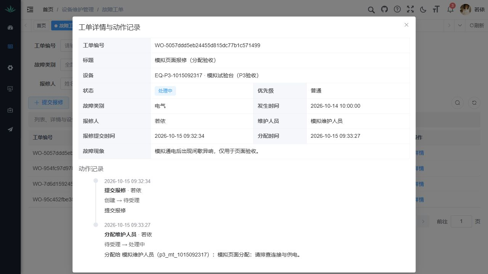

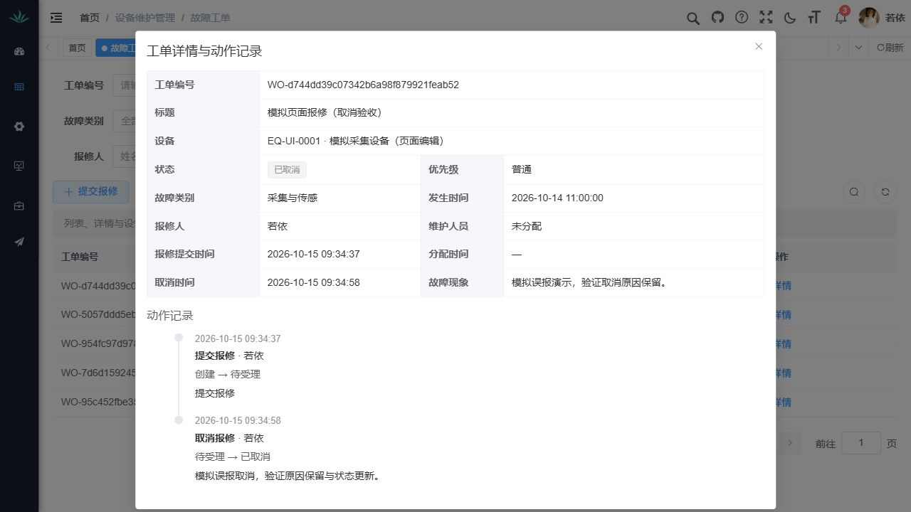

## P4维护处理与复核（2026-10-15）

| 项目 | 实际结果 |
| --- | --- |
| 迁移 | 005已在本机执行两次，process/submit/review共3项权限各一条；只补角色菜单关系，无新增表和账号角色重置 |
| 后端 | 全模块package成功；61项单元、10项真实MySQL Mapper/事务测试全部执行，Failures=0、Errors=0、Skipped=0 |
| 前端 | build:prod成功，无新增依赖 |
| WO-07 | 实际API当前维护人员追加成功；本人报修、纯管理角色拒绝，其他维护人员范围外404；空白、超长400 |
| WO-08 | 三字段分别必填，版本必填；提交转待复核，服务端写最近提交时间，伪造状态和关闭时间无效；待复核禁止追加与重提 |
| WO-09/10 | 退回及通过说明必填，非法decision400；退回保留处理人，第二轮提交独立保存，通过写关闭时间，关闭后写入拒绝 |
| WO-11 | 两轮完整流程共7条记录，第一轮结果和退回说明未覆盖；报修人员能查本人完整记录，时间/ID排序稳定；设备历史关联一致 |
| WO-12 | 实际并发追加与提交返回200/409，只多一条记录；并发通过与退回返回200/409，只执行一次决定 |
| 回滚 | 真实MySQL临时表CHECK约束分别拒绝PROCESS_NOTE、SUBMIT_REVIEW、REVIEW_REJECT、REVIEW_APPROVE记录；状态、版本、时间、处理人及记录数量均回滚 |
| 设备状态 | 通过关闭不修改设备使用状态；无未结束工单时未结束数归零 |
| 审查 | 以47de9fe为固定起点，Standards与Spec分别审查，均无可操作发现；审查不替代动态验收 |
| 页面 | 获本次P4登录与验证码授权。追加处理必填拦截正常，保存后新增时间线；原因/措施/结果分别必填，第一轮提交转待复核且维护按钮收起；退回原因必填，退回保留原维护人；第二轮重提成功，通过结论必填且确认框展示工单号，通过后显示关闭时间且仅查询；设备历史打开同一工单，两轮结果、退回原因及通过说明完整；控制台无error/warn |

43项实际API检查结果在忽略提交的 `equipment-backend/xiaokang-admin/target/p4-api-results.json`。模拟设备 `EQ-P4-1015100542`，三张工单均明确标记API或UI用途；初次脚本创建的超长测试账号因若依用户名长度上限不能登录，已停用，随后按框架上限生成账号验收通过，未改动产品账号规则。

10项MySQL测试仍使用专用连接的临时业务表克隆，不写常规业务表，资格候选虚拟化与外键限制沿用P3说明；跨连接竞争通过实际API补充。测试连接由本机忽略提交的配置读取，仅传给测试子进程，没有将密码加入仓库或共享文档。API验收的四个单角色模拟账号及页面验收的双角色模拟账号均已停用，测试会话全部登出；本地上下文已移除密码和令牌，模拟业务记录保留供演示。页面使用双角色账号验证同一组件的操作与显示，角色隔离另由单角色API验收覆盖。

页面工单 `WO-55c153fa535443fe88e04749a3f60331`，2026-10-15 11:41:50通过关闭，version=6，共7条动作记录。保存后通过接口再次核对两轮结果和设备状态；本地验收摘要 `equipment-backend/xiaokang-admin/target/p4-ui-results.json`，不含密码或令牌。

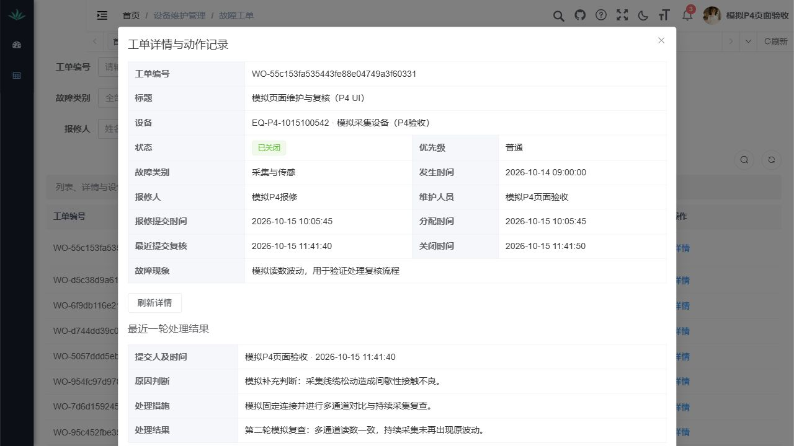

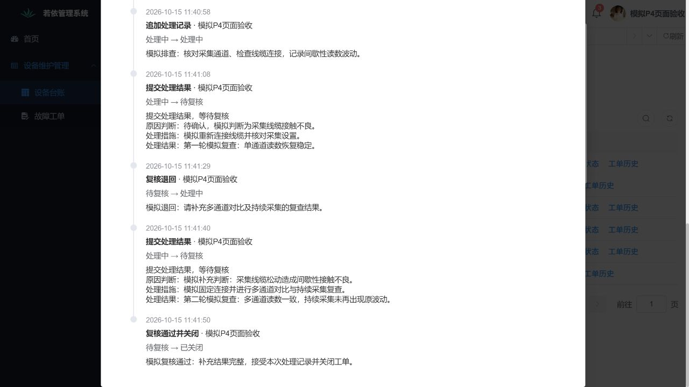

## P5基础统计与工单导出（2026-10-15）

实现起点为 `5219e54fced4c2ff1dc1903d6d2d5507274d35e7`。沿用本机开发环境，最新后端8080、前端5173、Redis6399。统计与导出均使用明确标注的模拟业务数据。

| 项目 | 实际结果 |
| --- | --- |
| 迁移 | 006在本机执行两次，统计和导出两项权限各一条，按既定角色追加菜单关系，不改变账号业务角色；项目库仍34表 |
| 后端构建 | 完整多模块package成功，全部85项测试通过，Failures=0、Errors=0、Skipped=0 |
| 测试构成 | EquipmentService20、StatisticsService7、WorkOrderService21、WorkOrderRequest2、WorkOrderWorkflow21，共71项单元；WorkOrderMySql14项真实数据库测试 |
| 前端构建 | 图表生命周期及文字描述修复后再次执行build:prod成功，无新增依赖 |
| T-15口径 | MySQL临时表夹具覆盖5种状态、日期范围前后午夜、全局设备状态、取消排除及1.50小时平均值；13台设备夹具检验排名只取前10、同数按编号排序、只有取消工单的设备排除 |
| 快照事务 | 通过实际Spring事务代理调用，断言只读事务已激活且JDBC隔离级别为REPEATABLE_READ；没有另行构造统计查询中途并发写入的确定性测试 |
| T-16导出 | 专门导出对象16列，单元测试实际生成XLSX后用POI核对表头、中文标签、时间与字符串类型；真实MySQL临时表1000条允许，1001条拒绝；不使用分页 |
| API权限 | 未登录统计401；纯报修、维护账号统计403；管理角色可查询；伪造报修人过滤不能扩大导出范围 |
| API统计 | 设备A共6条工单，待受理2、处理中1、待复核1、已关闭1、已取消1；总数6、未结束4、已关闭1；类别机械3、电气2，设备报修次数5。设备B仅取消工单，类别和排名为空；设备C无工单，平均值为null |
| API筛选 | 当天及设备筛选返回6条；未来日期返回0但设备总数仍9；非法日期、倒置区间、设备ID非正返回400；快速关闭的模拟工单平均值四舍五入为0.00，不与无数据混淆 |
| API导出 | 设备A按报修甲、报修乙、管理、维护、双角色分别导出3、2、6、2、2条；逐一与同账号同条件列表编号集合一致，传入pageNum=99/pageSize=1仍不限制导出；已关闭筛选、中文标签、流程时间、空表头文件与非法日期错误均核对 |
| 页面筛选 | 获本次P5登录及验证码授权。设备A与当天筛选显示9台全局设备、6条工单、4条未结束、1条已关闭；筛选URL刷新后恢复；2099年空结果显示无数据，设备指标仍保留 |
| 图表恢复 | 复现并修复非空图表→表格→空结果→非空结果→图表时旧实例依附已移除容器的问题。修复后相同步骤SVG及2/1/1/1/1计数恢复，aria描述只含真实分类、数量与单位 |
| 移动布局 | 临时390×844视口实测document宽度390、单列图表及双列摘要，无页面水平溢出；验收后已恢复原视口 |
| 浏览器导出 | 搜索已关闭模拟工单只剩1条，点击导出成功。解析实际下载XLSX共2行（表头+1条），16列、编号匹配，电气/普通/已关闭标签和关闭时间正确，无公式单元格 |
| 控制台与审查 | 验收期间控制台error/warn为空。Standards与Spec独立审查共同发现一项图表实例生命周期P2问题，已修复并通过聚焦复查；无剩余可操作发现 |

46项P5实际API检查结果位于忽略提交的 `equipment-backend/xiaokang-admin/target/p5-api-results.json`，浏览器摘要为 `p5-ui-results.json`；后端测试日志为 `equipment-backend/target-p5-package.log`，前端构建日志为 `equipment-frontend/target-p5-build.log`。日志与下载样本不提交Git。

本次模拟设备 `EQ-P5-A-1015151303`（混合状态）、`EQ-P5-B-1015151303`（仅取消）、`EQ-P5-C-1015151303`（无工单）。页面导出工单为 `WO-2a3eab7b60b64511b7bea3f28e789046`；实际文件位于本机 `Downloads/workorders_1792049158054.xlsx`。数据仅用于学习验证，不代表真实设备成效。

真实MySQL测试沿用专用连接临时表，不写正常业务表；正式外键及跨连接锁行为仍按P3/P4限制说明。API模拟业务记录保留供演示，本次5个模拟账号均已停用并读取状态核对，已知测试会话已登出；本地上下文去除密码与令牌，没有修改正常用户。

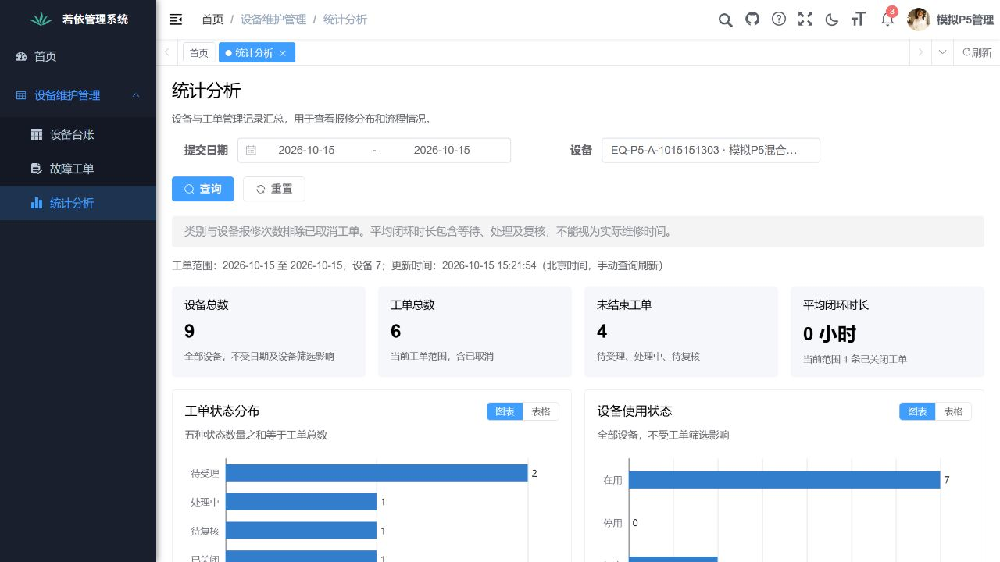

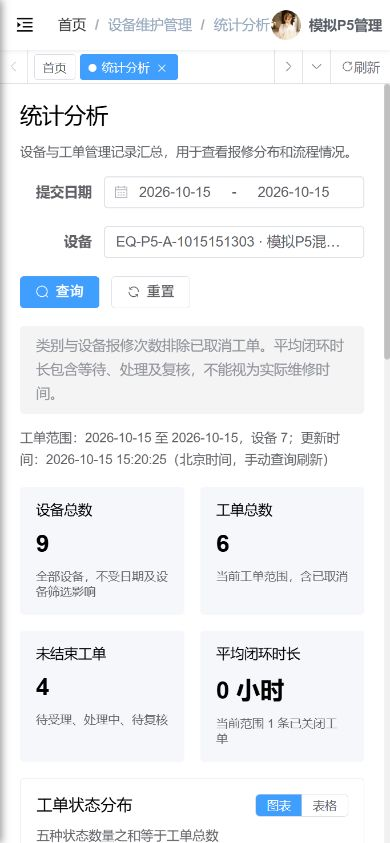

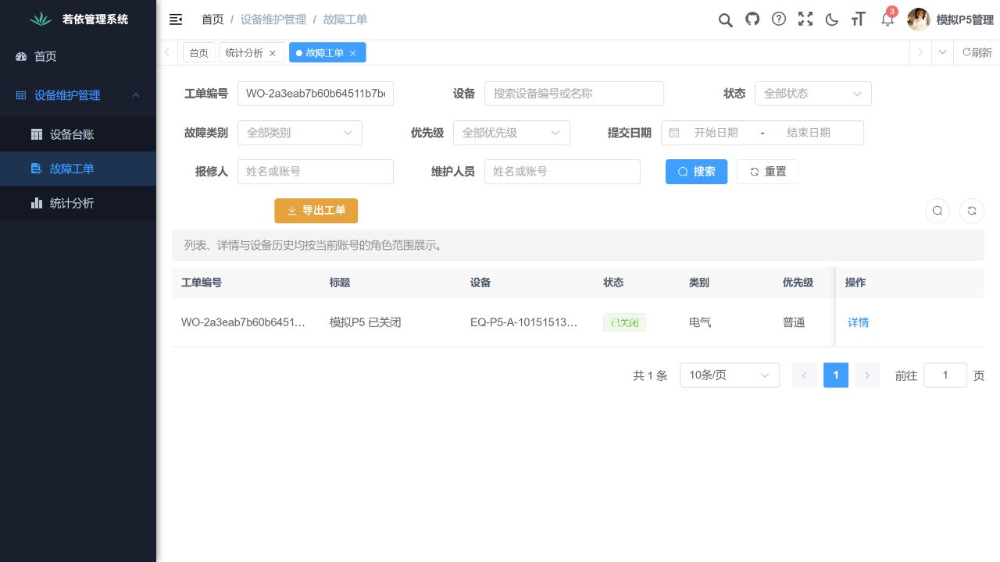

## P6空库复现与本地交付（2026-10-15）

以P5提交 `57490eb397f732a3140e7bd48ca3a8c791e5f550` 为起点。为避免原有库、缓存及打包产物掩盖问题，本次使用独立MySQL3307数据目录、Redis6400进程，以及无原target/node_modules的源码副本，后端8081、前端5174。源码来自任务工作树暂存内容；后续首页修订同步到该副本后重新生产构建。

| 项目 | 方法及实际结果 |
| --- | --- |
| 空数据库 | 独立MySQL8.0.37实例创建equipment_maintenance_demo；导入前表数0。按固定框架ry_20260417、quartz与业务001至006顺序导入后34表 |
| 初始化保护 | 同一数据库再次调用initialize_database，因非空拒绝，未执行框架SQL；没有DROP或清空正常开发库 |
| 干净后端 | 独立源码副本Maven clean package，71项单元+14项真实MySQL测试共85项，Failures=0、Errors=0、Skipped=0，BUILD SUCCESS；测试连接使用3307隔离实例 |
| 干净前端 | 独立副本重新npm ci，安装527包；build:prod成功，项目首页调整后再次构建成功。未拷贝原node_modules/dist，未强制升级依赖 |
| 启动与代理 | 新JAR在8081启动成功，独立Redis6400连通；5174/dev-api/captchaImage返回独立应用验证码响应，浏览器实际登录及菜单加载成功 |
| 演示生成 | 调用交付seed_demo的同一seed函数，经正常用户、设备、工单API，生成5个单角色账号、10设备、20工单、63条动作。验收驱动读取独立Redis内本次CLI登录生成的验证码键；交付CLI仍为getpass加人工读图，不关闭验证码 |
| 数据分布 | 五种工单状态各4张，总数20、未结束12、已关闭4；设备在用8、停用1、报废1；类别排除取消后合计16。快速模拟关闭平均值为0小时，是实际流程时间四舍五入结果 |
| 菜单及范围 | 五账号均成功登录，getInfo仅各自一个业务角色；三类均有工单菜单，仅管理有统计。报修甲/乙各10张，维护甲/乙各6张，管理20张；导出编号集合与列表一致且16列 |
| 两轮结果 | 模拟工单04，编号WO-6f1beddbd6b449aeaac6e129a8b77f79，8条动作，含两次提交、一次退回和最终通过。第一轮结果未覆盖，另一报修及维护账号读取404；关闭后追加、待复核重提均400 |
| 设备规则 | 停用009、报废010均拒绝新报修；设备002历史包含同一张两轮已关闭工单 |
| 正式外键 | 三张正式业务表5条外键存在；插入不存在设备的工单、插入不存在工单的动作均由MySQL返回1452，断开事务后数据数量不变 |
| 重复业务迁移 | 重跑业务001至006，10设备/20工单/63动作/7用户数量不变；同父级、类型、路径与权限的业务菜单无重复。没有重跑含DROP的框架SQL |
| 重复演示保护 | 已有凭据文件拒绝覆盖；换新输出目录后仍因已有业务数据拒绝，工单总数保持20；不重置已有密码 |
| 实际API | 上述角色、范围、统计、导出、状态拒绝及初始化保护的52项检查均通过，结果在本地api-results.json |
| 浏览器 | 获本次P6登录与验证码授权，在5174登录manager01，核对项目首页入口、10台设备及停用/报废、20工单/12未结束/五状态各4、两轮结果与复核说明；从台账002工单历史打开同一详情。验收期间控制台error/warn为空；已退出登录 |
| 审查 | Standards与Spec以P5提交为固定起点分别只读审查，实现均无可操作发现；文档聚焦发现一处P2历史状态措辞，已注明阶段，最终交付文档与README同步 |

本机验收目录 `.local/p6-20261015` 被Git忽略：backend-build.log、frontend-install.log、frontend-build.log、api-results.json、database-results.json。demo子目录内demo-manifest.json是实际账号以外的业务清单，demo-accounts.json包含仅本机使用的随机密码，不提交或分享。CLI生成和API验证会话均在finally中登出，浏览器会话另行退出；5个演示账号保留启用，与前期已停用的临时测试账号不同。独立实例保留运行供本机预览，原开发服务及业务数据未被初始化脚本覆盖。

构建使用现有Maven依赖缓存和已安装工具；npm报告的16项依赖告警未在此阶段强制升级。并发、临时表与外键的实测边界沿用各阶段说明，不把本机空库复现等同于线上部署或生产安全验收。

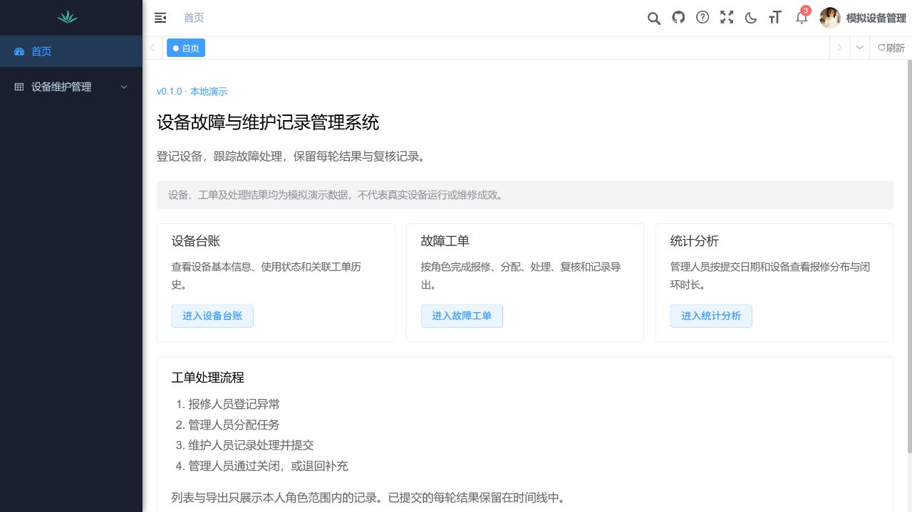

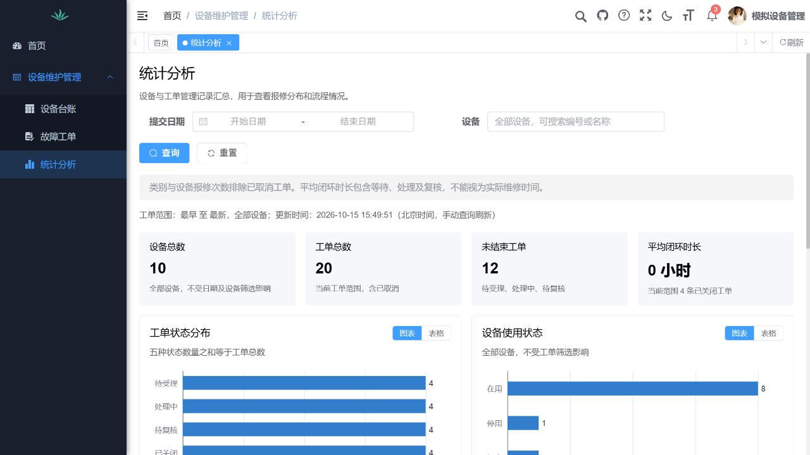

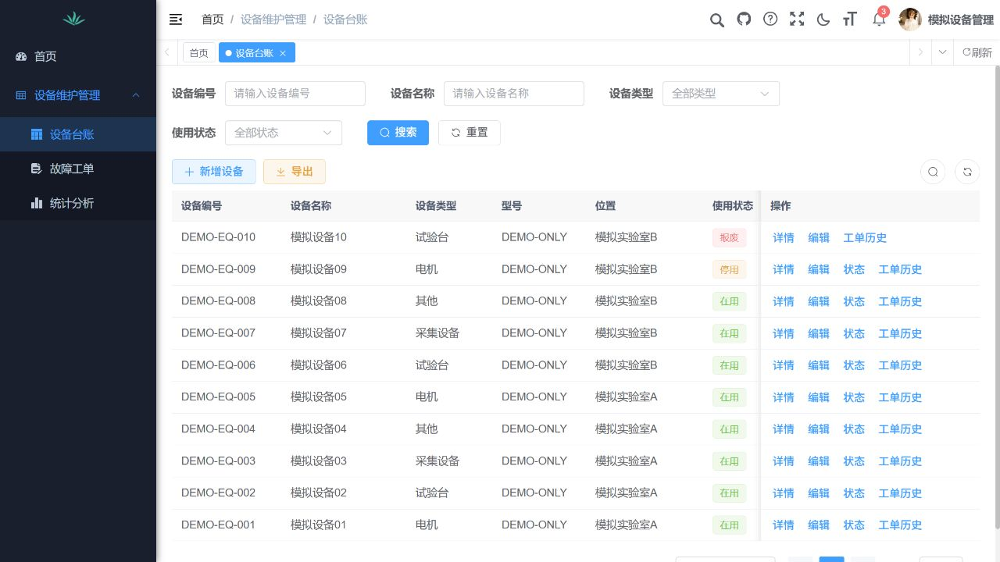

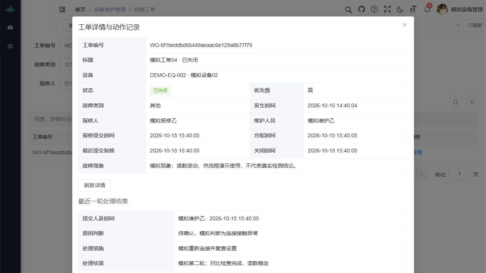

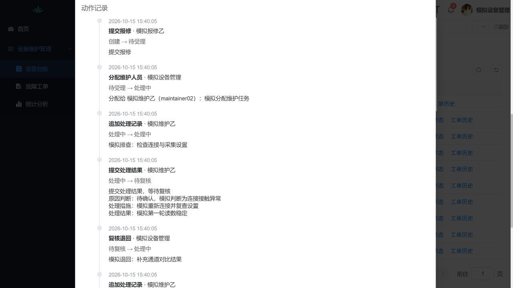

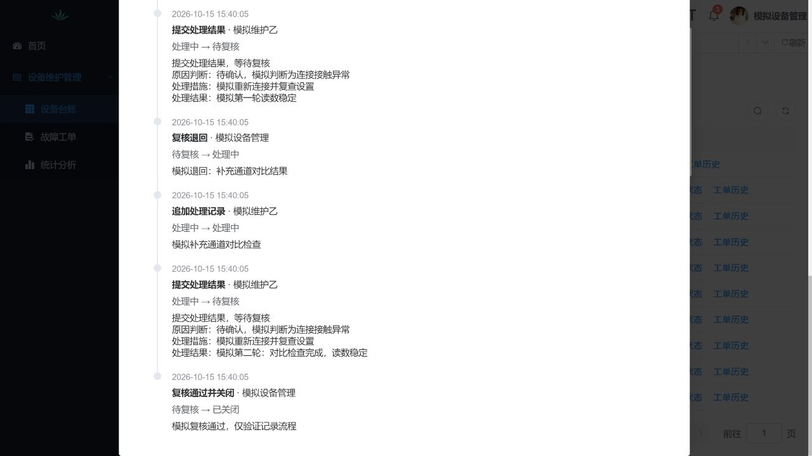

## 首版验收索引

| 场景 | 覆盖与证据 |
| --- | --- |
| T-01重复设备编号 | P2单元、API及页面 |
| T-02非在用设备报修 | P3规则/API，P6停用与报废正式实例拒绝 |
| T-03正常关闭 | P4流程测试/API/页面，P6演示API及页面 |
| T-04退回重提 | P4两轮流程测试/API/页面，P6八条正式动作 |
| T-05必填结果 | P4单元/API/页面必填拦截 |
| T-06他人维护 | P4 API范围拒绝，P6另一维护读取404 |
| T-07报修对象范围 | P3 API/Mapper，P6另一报修详情及记录404 |
| T-08筛选与导出越权 | P5单元/SQL/API，P6五账号列表与导出编号集合 |
| T-09过期与并发动作 | P3/P4版本与真实API并发竞争，P4关闭与退回仅一次成功 |
| T-10回滚 | P3/P4真实Spring代理、MySQL临时表写入约束失败回滚 |
| T-11取消状态规则 | P3单元/API/页面 |
| T-12关闭后拒绝 | P4单元/API，P6已关闭追加400 |
| T-13报废前未结束检查 | P3/P4 API及测试，P6仅无未结束的010成功报废 |
| T-14报修与报废竞争 | P3跨连接真实API200/400结果 |
| T-15日期及空均值 | P5单元/真实Mapper/实际API/空结果页面 |
| T-16导出上限 | P2设备导出单元/API/浏览器；P5工单1000/1001真实MySQL与XLSX测试、实际API及浏览器下载 |
| T-17禁用维护账号 | P3单元/API及维护候选校验 |
| T-18空库复现 | P6独立实例、干净源码构建、52项API及真实页面 |

P0至P6首版本地演示范围验收完成。已知限制及未覆盖的生产部署事项见 [交付说明](release-v0.1.0.md)。
