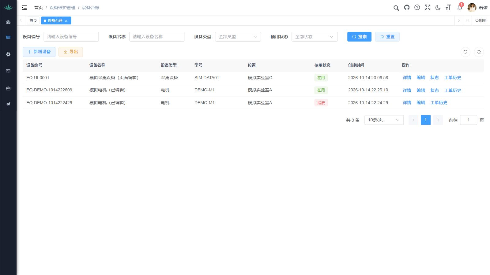

# 验证记录

日期：2026-10-14。实现提交：`be94f47`（后续修正见 Git 提交记录）。环境：Windows PowerShell，Java17、Maven3.9.16、Node24.13.0，MySQL8.0.37；项目库 `equipment_maintenance`，Redis6399，后端8080，前端5173。

## P2设备台账

| 项目 | 方法及实际结果 |
| --- | --- |
| SQL结构 | 本机执行001脚本，设备及工单表创建成功，项目库33表；外键DDL被MySQL接受 |
| SQL重复初始化 | 002菜单脚本执行两次，业务菜单8项、业务角色3项，无重复；保留原版系统数据 |
| 后端构建 | `mvn package '-DskipTests=false' '-Dmaven.test.skip=false'` 完整多模块打包成功 |
| 单元测试 | JUnit5 + Mockito共20项，Failures=0、Errors=0、Skipped=0；覆盖编号、字段、角色、停用账号、版本、报废、历史范围、分页清理、导出上限与字典回退，不连接或清理开发数据库 |
| 前端构建 | `npm.cmd run build:prod` 成功；没有强制升级若依依赖 |
| 运行 | 最新后端启动成功，MyBatis映射加载正常，实际HTTP接口响应正常 |
| EQ-01 / T-01 | API新增模拟设备成功，编号首尾空格删除、转大写、ID为字符串、初始在用；重复编号400，原记录未覆盖 |
| EQ-02 | API编辑名称成功，伪造编号和状态字段不改变设备编号、状态，返回版本递增 |
| EQ-03 | 按编号筛选，total=1、rows=1；两条真实数据按每页1条查询第2页，total=2、rows=1；停用设备不出现在在用选择接口 |
| EQ-04 | API停用、恢复在用成功；报修账号直接调用状态接口403；实际API报废200、再次恢复400；未结束工单报废拒绝通过Service单元测试 |
| EQ-05 | 实际API无工单返回空历史；报修账号可读取设备历史入口；角色范围参数并集及分页顺序通过单元测试。非空历史、P3详情与多角色SQL范围已在下节P3验收；维护复核详情留待P4 |
| EQ-06 / T-16 | 按编号导出真实XLSX，解压核对编号、电机与在用中文标签存在；报修账号导出403；超1000条拒绝通过单元测试，1001条真实数据库导出尚未执行 |
| T-09部分 | 实际API旧版本编辑409；多线程真实数据库竞争尚未执行 |
| 权限 | 实际新建模拟报修账号，读取200、新增403、状态403、导出403；停用账号后使用原令牌读取403；模拟账号验收后均停用 |
| 错误 | 未登录读取401、不存在设备404；缺失字典及无效字段通过单元测试，返回可理解的业务错误 |
| 浏览器 | 已授权本次本地登录并完成验证码。空表单拦截必填项；新增EQ-UI-0001成功并规范化为大写；编辑编号禁用，名称位置修改后列表详情一致；状态调整显示0条未结束工单，停用及恢复成功；报废设备没有状态按钮；历史显示范围内暂无工单；编号筛选1条，重置恢复3条；浏览器下载XLSX成功且内容一致。控制台无error/warn |

测试没有清空项目库或Redis。API及浏览器验收使用三条明确标注的模拟设备，保留供本地演示；模拟报修账号已停用，测试令牌已登出。自动化数据库集成测试仍须使用独立测试库，本次实际API检查不等同于完整集成测试套件。

可复用命令：

```powershell
Set-Location 'D:\VSCode\workspace\equipment-maintenance\equipment-backend'
mvn -pl ruoyi-system -am test '-DskipTests=false' '-Dmaven.test.skip=false'
mvn package '-DskipTests=false' '-Dmaven.test.skip=false'

Set-Location 'D:\VSCode\workspace\equipment-maintenance\equipment-frontend'
npm.cmd run build:prod
```

构建前须先停止占用当前JAR的后端。单元报告位于 `equipment-backend/ruoyi-system/target/surefire-reports/`。本机API结果和导出样本位于忽略提交的 `equipment-backend/ruoyi-admin/target/equipment-api-results.json` 与 `equipment-demo.xlsx`；结果文件不包含令牌或密码。

## 浏览器验收证据

验收设备EQ-UI-0001，模拟采集设备，页面新增后编辑名称和位置，停用后恢复在用。桌面表格各列、状态和操作按钮显示正常；临时验收窗口尺寸已恢复。



浏览器下载文件：本机 Downloads/equipment_1791990569167.xlsx。实际解析工作表共2行（表头+1条筛选数据），包含EQ-UI-0001、采集设备、模拟实验室C、在用。下载样本未提交Git。

## P3故障报修、分配与取消（2026-10-15）

实现提交 `d0b617b`，取消字段契约修正和文档见后续Git记录。测试环境沿用本机MySQL8、Redis6399、后端8080、前端5173。

| 项目 | 实际结果 |
| --- | --- |
| 迁移 | 003新增动作记录表；004初始化类别、优先级及故障工单菜单权限。项目库34表，004重复执行后故障工单菜单仍为1项，未删除原有数据 |
| 构建 | 后端多模块package成功；前端build:prod成功 |
| 单元测试 | P2设备与共享授权20项、P3工单18项、取消请求契约2项，共40项通过 |
| MySQL事务/Mapper | 显式配置测试连接，4项通过；使用真实Spring事务代理、MyBatis及连接级临时业务表。验证创建记录失败回滚工单，分配记录失败回滚状态/处理人/版本，取消记录失败回滚状态；真实SQL验证本人范围、维护范围、多角色并集和时间线 |
| 实际执行数量 | 全部44项测试，Failures=0、Errors=0、Skipped=0；默认未配置MySQL环境时只执行40项单元，4项MySQL测试跳过 |
| WO-01/02/04 | 实际API创建唯一WO-UUID编号；ID为字符串，状态待受理，报修人与提交时间由服务端确定。伪造状态/报修人/编号不生效；未来时间、无效日历日期及错误JSON编号类型400 |
| WO-03 | 本人可见同设备未结束工单需要确认，未经确认409；另一报修账号不会因不可见工单收到提示；确认后可继续创建 |
| 范围 | 报修甲列表只有本人数据，伪造报修人筛选不能扩大范围；报修乙读取甲详情和记录均404；维护人员分配前看不到工单，分配后可读；设备历史采用相同范围 |
| WO-06/T-17 | 管理人员可选择有效维护账号并分配，状态处理中、version递增、分配时间及ASSIGN记录存在；非维护角色、停用维护账号拒绝，停用账号不出现在候选列表 |
| WO-05/T-11部分 | 空取消原因400；本人待受理取消成功，保留CREATE/CANCEL记录；处理中取消400；旧版本分配409 |
| T-09 | 真实并发分配与取消同一工单，返回200与409，最终仅有创建和一个动作记录，没有重复追加 |
| T-10部分 | 真实MySQL临时表约束故意拒绝记录写入，创建、分配、取消主表变更全部回滚；常规业务表未被这些测试写入 |
| T-13/14 | 实际API未结束工单阻止设备报废；真实并发创建报修与设备报废返回200与400，没有出现报废设备存在新未结束工单的结果 |
| 日期与人员筛选 | 当天报修提交日期加报修人姓名筛选，精确返回两条页面模拟工单，状态分别处理中和已取消；开始日期晚于结束日期400 |
| 浏览器创建 | 已获本次登录及验证码确认。空表单显示必填错误；在用设备候选不含报废设备；同设备已有1条未结束工单时显示提示并确认；提交后显示待受理和创建记录 |
| 浏览器分配 | 维护候选只包含有效模拟维护账号；填写说明后分配成功，详情显示处理中、维护人员、分配时间及CREATE/ASSIGN时间线 |
| 浏览器取消 | 第二条模拟报修空原因不能提交；填写原因后取消成功，详情显示取消时间、CREATE/CANCEL时间线及原始原因，列表不再提供分配或取消按钮 |
| 设备历史衔接 | 从EQ-UI-0001设备历史打开同一工单详情，状态及两条动作记录与工单页一致 |
| 浏览器筛选 | 已取消筛选返回3条，重置恢复5条；验收交互期间控制台无error/warn |
| 审查 | Standards未发现可操作问题；Spec发现取消字段应为reason，已统一DTO、Service、前端和文档，并兼容description别名；两项反序列化测试及页面取消均验证修复，复查无新增问题 |

35项实际API检查结果保存在忽略提交的 `equipment-backend/ruoyi-admin/target/p3-api-results.json`。后续又核对了日期/人员筛选和页面数据状态；取消的正式reason字段通过实际页面请求成功验证。临时验收上下文已去除密码与令牌。

实际API及浏览器验收留下明确标注模拟用途的设备、工单和动作记录，保留供演示；本次创建的模拟账号在验收后停用并登出所属测试令牌，没有修改原有正常用户。分配给模拟账号的历史保留其显示名。自行演示分配时需准备自己的启用维护账号，步骤见 `docs/work-orders.md`。

MySQL临时表克隆不复制正式外键，且单连接不模拟跨连接竞争；账号关联仅只读，维护目标资格在该测试中使用虚拟候选，另外通过真实API检查。生产DDL外键在迁移执行时验证，跨连接竞争通过实际API验证，均不以临时表结果替代。独立空库完整复现仍待P6。


## P4维护处理与复核（2026-10-15）

| 项目 | 实际结果 |
| --- | --- |
| 迁移 | 005已在本机执行两次，process/submit/review共3项权限各一条；只补角色菜单关系，无新增表和账号角色重置 |
| 后端 | 全模块package成功；61项单元、10项真实MySQL Mapper/事务测试全部执行，Failures=0、Errors=0、Skipped=0 |
| 前端 | build:prod成功，无新增依赖 |
| WO-07 | 实际API当前维护人员追加成功；本人报修、纯管理角色拒绝，其他维护人员范围外404；空白、超长400 |
| WO-08 | 三字段分别必填，版本必填；提交转待复核，服务端写最近提交时间，伪造状态和关闭时间无效；待复核禁止追加与重提 |
| WO-09/10 | 退回及通过说明必填，非法decision400；退回保留处理人，第二轮提交独立保存，通过写关闭时间，关闭后写入拒绝 |
| WO-11 | 两轮完整流程共7条记录，第一轮结果和退回说明未覆盖；报修人员能查本人完整记录，时间/ID排序稳定；设备历史关联一致 |
| WO-12 | 实际并发追加与提交返回200/409，只多一条记录；并发通过与退回返回200/409，只执行一次决定 |
| 回滚 | 真实MySQL临时表CHECK约束分别拒绝PROCESS_NOTE、SUBMIT_REVIEW、REVIEW_REJECT、REVIEW_APPROVE记录；状态、版本、时间、处理人及记录数量均回滚 |
| 设备状态 | 通过关闭不修改设备使用状态；无未结束工单时未结束数归零 |
| 审查 | 以47de9fe为固定起点，Standards与Spec分别审查，均无可操作发现；审查不替代动态验收 |
| 页面 | 验收进行中，待本次验证码确认后完成维护、退回、重提、关闭与历史显示 |

43项实际API检查结果在忽略提交的 `equipment-backend/ruoyi-admin/target/p4-api-results.json`。模拟设备 `EQ-P4-1015100542`，三张工单均明确标记API或UI用途；初次脚本创建的超长测试账号因若依用户名长度上限不能登录，已停用，随后按框架上限生成账号验收通过，未改动产品账号规则。

10项MySQL测试仍使用专用连接的临时业务表克隆，不写常规业务表，资格候选虚拟化与外键限制沿用P3说明；跨连接竞争通过实际API补充。测试连接由本机忽略提交的配置读取，仅传给测试子进程，没有将密码加入仓库或共享文档。API验收的四个单角色模拟账号已停用，测试令牌全部登出并从本地上下文移除；页面验收的双角色模拟账号暂保留启用，供待确认的页面流程使用。

## 尚未验证的第一版内容

统计、工单导出及T-18完整空库复现留待P5/P6。P4浏览器验收尚待完成；当前接口与事务结果不代替页面验收。第一版尚未交付。
